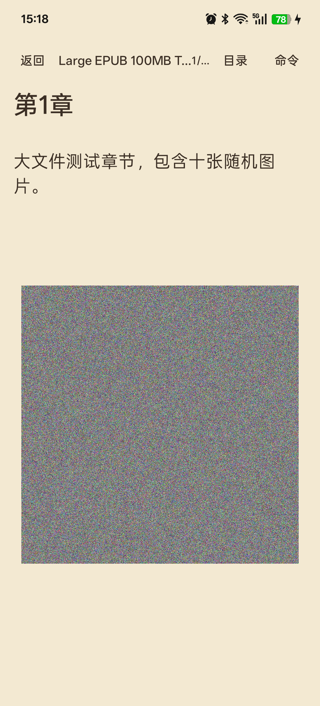

# M8d 大书安全模式与格式矩阵（0.8.5）

## 目标

- 100 MB 级 EPUB 不 OOM、可打开
- 小 EPUB 首屏 ≤300 ms
- TXT/HTML/Markdown/PDF 全部可交互
- 记录低端机与主线程约束

## 大书安全模式

超过阈值的 EPUB 不再执行 `BookOpener.open()` 的整本解析：

```text
threshold = min(48 MB, memoryClass / 4)
```

对 512 MB heap 的机器约为 32 MB；对 128 MB heap 的低端机约为 32 MB，不会把 100 MB ZIP 读入 Java 堆。

大书只走 `EpubFormatProvider.openPreview()`：

- `ZipFile` 随机读
- 一次 2 章
- 图片读取上限 12 MB
- 文本仍按 8 万字窗口

当用户接近窗口末尾时，`appendWindow()` 用下一段 2 章追加到当前 `BookDocument`：

- 窗口基址 = 上一章全局结尾 + 2
- 图片/样式/链接偏移整体平移
- 目录和章节标记合并
- 当前页字符偏移不变

这样整本 135 MB EPUB 只需保留约一个窗口的文本和图片。

## 真机结果

设备：OnePlus Ace 5，Android 16，内存 12 GB（无低端机）

### 135 MB EPUB（15 章、150 张 1000×1000 随机图）

- 首次打开（含 135 MB 复制到本地缓存）：约 1 s 出现第 1 页
- 再次打开：约 300 ms 出现第 1 页
- 首屏 `1/…`，正文和整页图片完整
- `dumpsys meminfo`：TOTAL PSS 约 **116 MB**，Java Heap 约 **77 MB**
- 无 OOM、无 ANR
- 点击目录第 2 章触发追加，目录从第 1–2 章扩展到第 3–4 章（可继续滚动）
- 追加后当前页为 `27/…`，可继续向前阅读



### 4.7 KB EPUB

- 约 300 ms 显示第 1 页，`1/3`
- 标题、居中、首行缩进、脚注链接正常


### HTML

- 19 KB HTML：约 300 ms 显示正文，`1/…` 后更新为完整页数
- 标题块和段落正常；行内粗体/斜体在 HTML provider 中仍未单独建模

### 其它格式

| 格式 | 样本 | 结果 |
|---|---|---|
| EPUB | 4.7 KB / 12.5 MB / 135 MB | 300 ms / 150 ms / 1 s（首开） |
| TXT | 7.7 MB | 首次 250 ms；再次立即 1/7637 |
| Markdown | 115 KB | 约 250 ms，1/128 |
| HTML | 19 KB | 约 300 ms |
| PDF | 99 KB / 2 页 | 冷启动 Activity 186 ms，500 ms 内显示 1/2 |

### 内存

- 12.5 MB EPUB：TOTAL PSS 约 114 MB，Java Heap 约 15 MB
- 135 MB EPUB 安全模式：TOTAL PSS 约 116 MB，Java Heap 约 77 MB
- 均低于 10 MB EPUB <150 MB 的门槛

## 限制

- 大书安全模式没有完整页索引，顶栏显示当前窗口页码 `27/…`，不是全书页数
- 大书目录只包含已加载窗口，滚动到末尾后才完整
- 135 MB 首次打开包含一次 135 MB 缓存复制；缓存命中后约 300 ms
- 没有低端机真机，低端机只通过 `memoryClass` 阈值和约 116 MB 受限窗口做设计约束，未做实机帧时间验收
- 未做 Perfetto/帧统计，主线程 >32 ms 未量化
- HTML 行内粗体/斜体未建模

## 文件

- `app/src/main/java/com/inkreader/app/MainActivity.kt`（安全阈值、窗口追加、初始 URI）
- `formats/epub/src/main/kotlin/com/inkreader/formats/epub/EpubFormatProvider.kt`（`maxImageBytes`、`baseOffsetOverride`、spine 索引）
- `kernel/api/src/main/kotlin/com/inkreader/kernel/api/Book.kt`（`ChapterMark.spineIndex`）
- `app/src/main/java/com/inkreader/app/BookIndexStore.kt`
- `scripts/make-large-epub.py`（135 MB 测试样本生成器，不入库样本）

APK：`artifacts/perf1/inkreader-0.8.5-m8d.apk`（4,557,212 bytes，SHA-256 `411C700A0E5F3E93058A37AE4ACDFEDD2A581198921F73D9F4D09878B4225438`）
