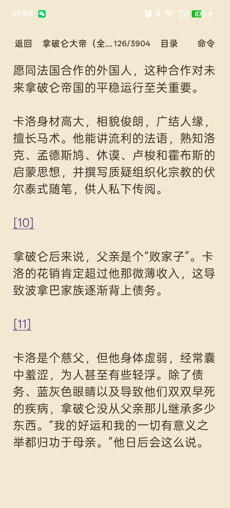
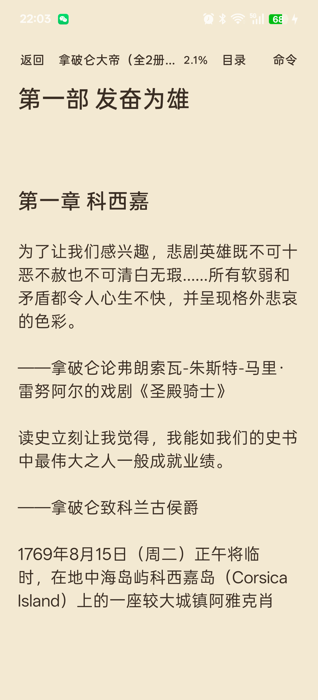

# 章节感知分页（0.9.1）

## 问题

原来 EPUB 被合并成一个连续 `Chapter`，分页只看页面高度。上一章结尾后，下一部的标题和正文会直接塞进同一页剩余空间，导致章节层级消失，也容易出现大段空白。

## 章节边界识别

优先级：

1. **NAV / NCX 目录目标**：同时保留 href 的 path 和 fragment，不再只保留 path。
2. **XHTML 标题**：`h1`/`h2` 的字符范围与 `id`。
3. **Spine 顺序**：只用于把各 XHTML 的局部边界换算成全书字符偏移。
4. **回退**：
   - 有目录但某文件没有目录项：只有 `h1` 作为安全边界，避免把跨文件章节的续页拆开。
   - 没有任何目录：使用 `h1`/`h2` 标题作为边界。
   - 没有目录也没有标题：不分页，保持连续正文。

不依赖中文章节名、固定字符数或屏幕高度。

## 多级标题处理

- 目录 fragment 精确映射到标题 `id`，而不是 XHTML 文件开头。
- 一个文件包含多个章节时，每个 `h2` 都产生边界。
- 跨多个 XHTML 的同一逻辑章节：后续文件没有目录项时，不会仅因 Spine Item 变化而强制分页。
- 部标题 + 紧邻章标题：如果两者之间只有标题文字和空白，合并为一个起始页。
- 部标题后如果有独立正文，再出现章标题，则保留两个边界。
- TOC 跳转目标会吸附到该章节起始页的边界，避免只看到章标题而漏掉部标题。

## 强制分页位置

没有改 EPUB 文件，也没有插入全局 CSS。边界保存在：

```kotlin
Chapter.pageBreaks: List<Int>
```

这是章节文本内的字符偏移，和图片/样式/链接使用同一坐标系。

`ReaderSurfaceView` 在分页时使用它：

- 全量分页：每页按高度得到自然结束行后，如果区间内出现边界，就把页尾收缩到边界所在行。
- 局部首屏：`localPageEndFor()` 同样在自然页尾前截断。
- 向前翻页：窗口起点不早于上一个边界，避免跨章。
- 页尾恰好是边界时，下一页从边界开始；边界在页首时不会产生空页。
- 边界只影响分页，不修改正文，因此字符偏移、图片、脚注和链接不受影响。

页索引布局签名升级为 `v3`，旧页索引自动失效并重建。

## 真机结果

设备：OnePlus Ace 5，Android 16  
书：《拿破仑大帝》12.5 MB EPUB

解析结果：

- 章节边界 45 个
- 第一部起点 24418，第一章 24430
- 第一章 TOC 目标吸附到 24418，和部标题同页
- 第二部/第三章等独立文件章节在各自文件起点分页

分页结果：

- 第 116 页：引言结尾 + 脚注 `[1]`，页尾留白
- 第 117 页：从“第一部 发奋为雄”开始，“第一章 科西嘉”紧随其后




关闭页码插件后，同一位置显示字符百分比 `2.1%`，从新页开始的部/章布局仍然成立；章节分页属于排版内核，不依赖页码插件。



页码从旧的 3889 变为 3904，是章节强制分页和布局签名升级后的预期变化；字符进度保持不变。

再把字号从 19 sp 调到 25 sp：页数从 3904 变为 6150，同一阅读位置仍是第 169 页，并且仍从“第一部 发奋为雄”+“第一章 科西嘉”开始；调回 19 sp 后回到第 117 页。章节边界不依赖具体页数。

APK：`artifacts/perf1/inkreader-0.9.1-chapter.apk`（4,575,046 bytes，SHA-256 `6A720B8DC0DCE3785C1E768E7988AE6536A21ED4B752BAEEC311C843A1D6A827`）

## 自动化测试

`EpubFormatProviderTest` 新增：

- 普通两文件章节：边界在第二个文件起点。
- 单文件多章节：部+章连续标题合并，第二个 `h2` 单独分页。
- 跨文件逻辑章节：第二个文件无目录项时不分页。
- 无 NAV/NCX：回退到 `h1`/`h2`。
- 标题范围与 id 提取。
- TOC 内部章节偏移吸附。

## 兼容性

- 非 EPUB 格式不设置 `pageBreaks`，分页行为不变。
- 阅读进度仍保存字符偏移；页数变化不影响百分比。
- 目录跳转使用吸附后的字符偏移。
- 字号、行距、边距变化会重新分页，边界数据不变。
- 图片、脚注链接和普通超链接仍使用原字符偏移。
- 大书窗口追加会平移新增章节的 `pageBreaks`。

## 限制

- 没有目录且没有 `h1`/`h2` 的 EPUB 无法识别章节，只能连续分页。
- 没有目录时，如果 `h1` 是章、`h2` 是小节，可能把小节当章节分页；有目录时会优先按目录项判断。
- 目录 fragment 指向非标题锚点（例如脚注）时不会产生章节边界。
- 部标题和章标题之间如果有图片等非文本占位，可能被视为有独立内容而保留两个边界。
- 页数和页码是布局结果，换字号/屏幕后仍会变化。
