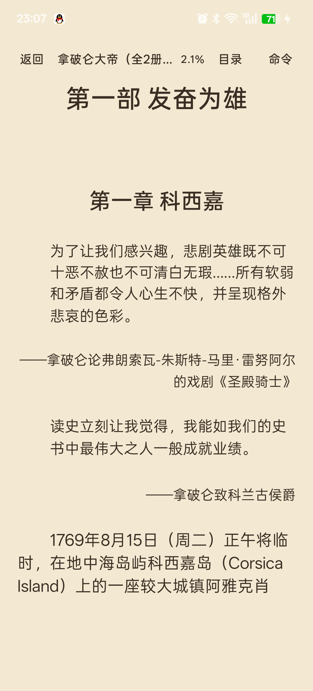

# EPUB 排版优化（0.9.2）

## 真正的根因

这次不是标题解析缺失，而是三个问题叠加：

1. **外部 CSS 从未加载**
   - `XhtmlText` 只解析 XHTML 内联 `<style>`
   - 《拿破仑大帝》的 `h1`/`h2` 居中、`p` 首行缩进、`.block`/`.lk` 引语样式全部在 `flow0001.css` 中
   - 因此标题一直左对齐，正文一直没有首行缩进

2. **标题匹配到了错误的 CSS 选择器**
   - `markAlignment()` 把所有标题都当作 `"h"` 查询样式
   - CSS 实际是 `h1`、`h2`、`h3`
   - 即使注入了 CSS，标题也拿不到对应规则

3. **段落被当成独立文本块**
   - 每个 `</p>` 无条件变成空行
   - 没有区分正文、引语、出处和特殊块
   - 引语没有独立语义，标题也没有独立字号/对齐策略

修复顺序因此是：先加载原始 CSS，再按真实标签解析，最后补全阅读器默认排版。

## 标题层级

### 识别

- `h1` → 部/卷级
- `h2` → 章级
- `h3` → 小节级
- `h4`–`h6` → 更低级标题，保留文本但不参与章节分页

标题边界仍沿用上一阶段的 `Chapter.pageBreaks`，不受字号、对齐和间距影响。

### 样式

- `h1`：1.55× 正文字号，粗体
- `h2`：1.35×，粗体
- `h3`：1.15×，粗体
- `h1`/`h2` 默认居中；EPUB 明确 `text-align:left/center/right` 时尊重原样式
- 标题前后的空行由段落/章节结构控制，不再对每个标题机械插入分页符

## 章首引语（Epigraph）

### 识别依据

新增 `RichParagraph` 元数据，记录每个段落的：

- XHTML 标签（`p` / `blockquote`）
- class 列表
- CSS 对齐
- 是否显式设置首行缩进
- 左右 margin（em）
- 相对字号

分类规则：

1. 只检查**标题之后、正文第一段之前**的连续段落组
2. 段落满足以下任一条件时视为引语：
   - `blockquote`
   - CSS 左右 margin ≥ 0.8em
   - CSS 字号明显小于正文
   - class 明确含 `epigraph` / `quote` / `blockquote` 等语义
3. 出处满足任一条件：
   - 右对齐
   - 文本以 `—` / `–` 开头
   - class 含 `source` / `cite` / `author` / `attribution`
4. 整组至少包含一个引语段，否则不标记
5. 正文第一段出现后立即停止，因此正文中间的普通 `blockquote` 不会被误判为章首引语

《拿破仑大帝》实际结构：

```html
<p class="block">为了让我们感兴趣……</p>
<p class="lk">——拿破仑论……</p>
<p class="block">读史立刻让我觉得……</p>
<p class="lk">——拿破仑致科兰古侯爵</p>
<p>1769年8月15日……</p>
```

`.block` 的 CSS 是 `margin-left/right: 2em; font-size: 0.9em`，`.lk` 是右对齐、`margin-right: 2em`。前者被识别为引语，后者被识别为出处，最后一段普通正文终止引语组。

### 排版

- `EPIGRAPH`
  - 0.92× 字号
  - 左侧缩进约 2em
  - 不用普通正文首行缩进
- `EPIGRAPH_SOURCE`
  - 0.85× 字号
  - 右对齐
  - 不用普通正文首行缩进

引语和出处仍是非分页内容，只有章节边界会强制换页；过长引语允许正常分页。当前没有实现“引语+出处必须同页”的 keep-together 约束。

## 正文首行缩进

- 优先使用 EPUB CSS 的 `text-indent`
- 中文书且 EPUB 没有提供缩进时，正文段落默认缩进 **2em**，段落之间使用单换行
- 非中文书不套用中文 2em 规则，保持原有段落间距
- 标题、`blockquote`、引语、出处、图片说明、列表、诗歌、note 等不套用默认缩进
- 缩进宽度按当前正文字号动态计算，不是固定 24dp
- 正文段落之间由双空行改为单换行，避免“2em 缩进 + 大段间距”同时出现

### 跨页续接

新增 `FirstLineIndentSpan`，记录段落起始字符偏移。

`ReaderSurfaceView` 在切页时：

- 如果页面起点在段落中间，移除该段落的 `FirstLineIndentSpan`
- 只有真正的新段落才重新缩进

实测第 118 页顶部是上一段续接的 `（Ajaccio）...`，没有重复缩进；下一段 `波拿巴家族...` 才正常缩进。

## 代码模块

- [XhtmlText.kt](<inkreader/formats/epub/src/main/kotlin/com/inkreader/formats/epub/XhtmlText.kt>)
  - 真实 `h1`–`h6` 标签匹配
  - 外部 CSS 选择器模型扩展
  - 段落元数据、段落分隔符
  - blockquote 语义标记
- [EpubFormatProvider.kt](<inkreader/formats/epub/src/main/kotlin/com/inkreader/formats/epub/EpubFormatProvider.kt>)
  - 读取 `<link rel="stylesheet">` 并注入样式
  - 章首引语识别
  - 中文默认缩进
  - 标题默认居中
- [Book.kt](<inkreader/kernel/api/src/main/kotlin/com/inkreader/kernel/api/Book.kt>)
  - `EPIGRAPH` / `EPIGRAPH_SOURCE` / `ALIGN_LEFT`
- [MainActivity.kt](<inkreader/app/src/main/java/com/inkreader/app/MainActivity.kt>)
  - 标题字号、引语/出处 span
  - 动态 2em 缩进
  - 字号变化时重建富文本
- [ReaderSurfaceView.kt](<inkreader/reader-engine/src/main/kotlin/com/inkreader/reader/engine/ReaderSurfaceView.kt>)
  - 分页切片移除跨页续接的首行缩进
  - 布局签名 `v4`
- [FirstLineIndentSpan.kt](<inkreader/reader-engine/src/main/kotlin/com/inkreader/reader/engine/FirstLineIndentSpan.kt>)
  - 记录段落起点

## 真机结果

设备：OnePlus Ace 5，Android 16  
书：《拿破仑大帝》12.5 MB EPUB  
设置：19 sp，1.5 倍行距，左右边距 20 dp

- 部标题居中、明显大于章标题
- 章标题居中、低于部标题但明显高于正文
- 部标题和章标题仍在同一章节起始页
- 章首引语左右缩进、字号小于正文
- 出处右对齐、字号更小
- 正文首行缩进 2em，段间不再使用大空行
- 第 118 页段落续接没有重复缩进
- 章节边界仍正确，第 117 页仍从“第一部 发奋为雄”开始




## 自动化测试

`EpubFormatProviderTest` 新增：

- 外部 stylesheet 的 `h1`/`h2` 居中和 `p` 缩进被加载
- 章首 blockquote 被识别为 `EPIGRAPH`
- 出处被识别为 `EPIGRAPH_SOURCE`
- 正文中间的 blockquote 不会被误判为章首引语
- 无目录 EPUB 的标题回退和默认居中
- 中文正文默认 `FIRST_LINE_INDENT`
- 英文正文不套用中文默认缩进

原有章节分页、TOC 偏移、跨文件章节、大书窗口等测试保持通过。

## 已知限制

- 外部 CSS 只支持 `<link rel="stylesheet">`；不支持 `@import`、复杂选择器、媒体查询和 CSS 变量
- 只读取对齐、首行缩进、左右 margin、字号比例；字体、颜色、字重等原始 CSS 仍未完整还原
- 章首引语依赖标题后的连续结构；如果 EPUB 用无 class 的普通 `<p>` 模拟引语，无法可靠识别
- `<div class="epigraph">` 包裹但内部段落没有 class/margin 的结构暂不识别
- 引语与出处没有 keep-together 分页保护，极长引语可能从中间分页
- 标题的上下 margin 用段落空行近似，不是完整 CSS 盒模型
- 页索引布局签名升级为 `v4`，旧页索引重建一次
- 页数会随字号/字距/屏幕变化；阅读进度仍用字符偏移
- 未重新做低端机/超大 EPUB 排版性能验收

## 发布

APK：`artifacts/perf1/inkreader-0.9.2-typography.apk`（4,591,430 bytes，SHA-256 `4DB94736648784D15A3C47E84801CC7357009963471FA8E775CA2D1FEA251FDD`）
