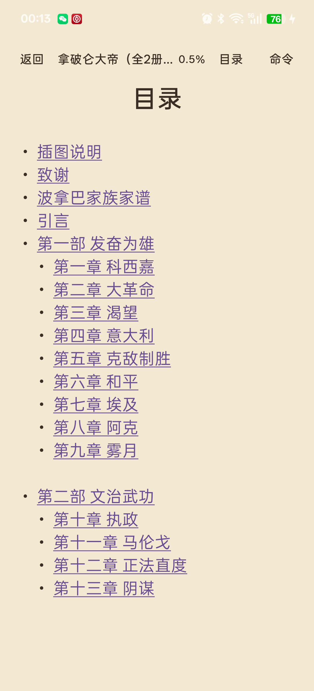
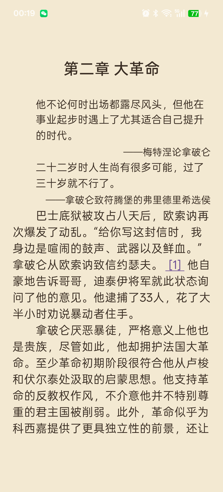
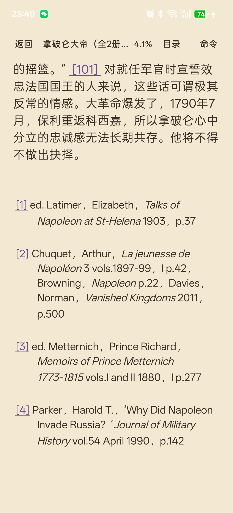

# EPUB 内部导航与脚注（0.9.3）

## 根因

这一阶段不是单独的 UI 问题，而是解析、链接和分页三处结构信息丢失。

### 1. 脚注引用被拆成新行

XHTML 中常见：

```html
拿破仑出生于科西嘉岛。
<a id="w1"></a>
<a href="#m1"><sup>[1]</sup></a>
后文继续。
```

原解析器把源码换行直接当成排版换行：

```kotlin
text.lines().joinToString("\n") { it.trim() }
```

结果 `[1]` 被推到新行，甚至看起来像一个独立段落。

### 2. 脚注区域没有语义

`<hr/>`、`<p class="note">`、`<a id="m1">`、返回链接 `<a href="#w1">` 都只是普通文本和普通链接。没有：

- 脚注分组
- 分隔线
- 脚注字号/缩进
- 脚注与正文的分页关系

### 3. 目录层级和链接在解析时丢失

- NCX 的 `navPoint` 被 `getElementsByTagName` 拉平，父子关系丢失
- NAV 的嵌套 `<ol>/<ul>` 没有被记录深度
- 目录页的 `<li>` 被直接去掉，只剩文字
- 预览窗口只加载前几章，目录页里指向后面章节的链接没有目标偏移，因此只有少数链接有链接样式

### 4. 链接点击只支持全书布局

`ReaderSurfaceView.handleLinkTap()` 只在 `textLayout` 非空时工作：

```kotlin
val layout = textLayout ?: return false
```

页码插件关闭时使用局部页布局，`textLayout` 为空，所有链接点击都失效。

## 实现

### 1. 行内脚注引用

保留 `<br>` 为硬换行，其余 XHTML 源码换行按 HTML 空白规则折叠为一个空格：

- `[1]` 与前后文字处于同一个 RichParagraph
- 不新增换行或段落
- 脚注编号仍是可点击的 `ReaderLinkSpan`

### 2. 目录层级

- NCX：递归遍历 `navMap` 的直接子 `navPoint`，保留父子深度
- NAV：按嵌套 `<ol>/<ul>` 维护列表深度，`<a>` 所在深度即目录深度
- `TocEntry.depth` 保留到 UI
- 目录页 `<li>` 生成项目符号，并按嵌套深度缩进
- 目录菜单同样使用 `depth` 缩进

### 3. 目录链接

新增稳定目标键：

```text
OEBPS/text00011.html#b001
```

而不是只保存当前窗口内的字符偏移。

- `TocEntry.targetKey`
- `ChapterLink.targetKey`
- `BookDocument.internalTargets: Map<String, Int>`

目标在当前窗口内时直接跳字符偏移；不在当前窗口时：

1. 保存 `targetKey`
2. 请求完整书
3. 全书加载后用 `internalTargets[targetKey]` 定位
4. 再按当前字号/行距重新分页

目录页中所有有 href 的条目现在都显示链接样式，并可在预览阶段点击。

### 4. 脚注区域

识别 `class="note"` / `footnote` / `endnote` 段落：

- `NOTE`：0.86× 字号 + 悬挂缩进
- `NOTE_SEPARATOR`：只在第一段脚注前绘制一条细线
- 去掉脚注段落继承的正文首行缩进
- 保留脚注编号和返回链接
- 脚注组保留在 EPUB 原始章节末尾，没有强行搬到每页底部

分隔线使用 `FootnoteSeparatorSpan`。页面从脚注组中间开始时，分页切片会移除分隔线和首行缩进，避免在页面中间重复绘制。

### 5. 链接点击

`ReaderSurfaceView` 的命中测试同时支持：

- 全书 `textLayout`
- 局部页 `localPageLayout`

局部页点击时使用 `localPageStart + layout 偏移`，再查全文字符串上的 `ReaderLinkSpan`。

## 代码模块

- [XhtmlText.kt](<inkreader/formats/epub/src/main/kotlin/com/inkreader/formats/epub/XhtmlText.kt>)
  - 软换行折叠、硬换行保留
  - `<hr>` 分隔
  - `<li>` 项目符号/嵌套缩进
  - 脚注段落元数据
- [EpubFormatProvider.kt](<inkreader/formats/epub/src/main/kotlin/com/inkreader/formats/epub/EpubFormatProvider.kt>)
  - NCX/NAV 层级
  - 全局目录顺序和 `targetKey`
  - `internalTargets`
  - 脚注样式、分隔线
- [Book.kt](<inkreader/kernel/api/src/main/kotlin/com/inkreader/kernel/api/Book.kt>)
  - `TocEntry.depth/targetKey`
  - `ChapterLink.targetKey`
  - `BookDocument.internalTargets`
  - `NOTE` / `NOTE_SEPARATOR`
- [ReaderLinkSpan.kt](<inkreader/reader-engine/src/main/kotlin/com/inkreader/reader/engine/ReaderLinkSpan.kt>)
  - `targetKey`
- [ReaderSurfaceView.kt](<inkreader/reader-engine/src/main/kotlin/com/inkreader/reader/engine/ReaderSurfaceView.kt>)
  - 局部页链接命中
  - 分隔线/缩进切片清理
- [FootnoteSeparatorSpan.kt](<inkreader/reader-engine/src/main/kotlin/com/inkreader/reader/engine/FootnoteSeparatorSpan.kt>)
- [MainActivity.kt](<inkreader/app/src/main/java/com/inkreader/app/MainActivity.kt>)
  - 目录深度缩进
  - 未加载目标的全书请求
  - 待跳转 `pendingLinkKey`
  - 脚注字号/悬挂缩进/分隔线

## 自动化测试

新增/更新：

- 脚注引用与前后文字保持同一段落，不出现 `\n[1]`
- 章首引语仍正确
- 正文中间引用不误判
- 目录 `depth` 为 `0,1,1`
- 目录 `targetKey` 支持预览窗口外目标
- 脚注 `NOTE` / `NOTE_SEPARATOR`
- 原有章节分页、排版、TTS/格式回归

全部通过：

```text
:app:test
:plugin-host-quickjs:test
:formats:epub:test
```

## 真机验证

设备：OnePlus Ace 5，Android 16  
书：《拿破仑大帝》12.5 MB EPUB

- 目录页：项目符号、部/章缩进、全部链接样式
- 目录菜单：父级和子级缩进
- 正文 `[101]` 与前后文字同一行
- 脚注区域：正文与脚注间细线，编号与内容同一行，续行悬挂缩进
- 点击预览目录中后面章节的条目：自动加载完整书并跳到目标
- 章节分页、标题、引语、正文缩进、跨页续接未回退







## 已知限制

- 脚注组仍在原书章节末尾；没有把所有 endnote 搬到当前页底部
- 没有实现浮层 footnotes/popup
- 同一脚注有多个正文引用时，返回链接以 EPUB 原始返回锚点为准；没有额外维护多引用列表
- 父级目录节点如果没有 href，目前不会生成可点击分组节点（本书没有这种情况）
- 预览阶段点击窗口外目标会请求完整书，需要等待全量解析
- 超长脚注仍会自然分页；没有做“脚注与出处必须同页”的 keep-together
- 页索引布局签名升级为 `v5`，旧索引会重建一次
- 目录当前选中项高亮尚未实现
- 非 EPUB 格式没有新增内部导航能力

## 发布

APK：`artifacts/perf1/inkreader-0.9.3-navigation.apk`（4,591,430 bytes，SHA-256 `0D25E0CCB60D10DA188C4605E0AC3A1B0365B6B7516AE1DD0FC546FA01AC35E7`）
