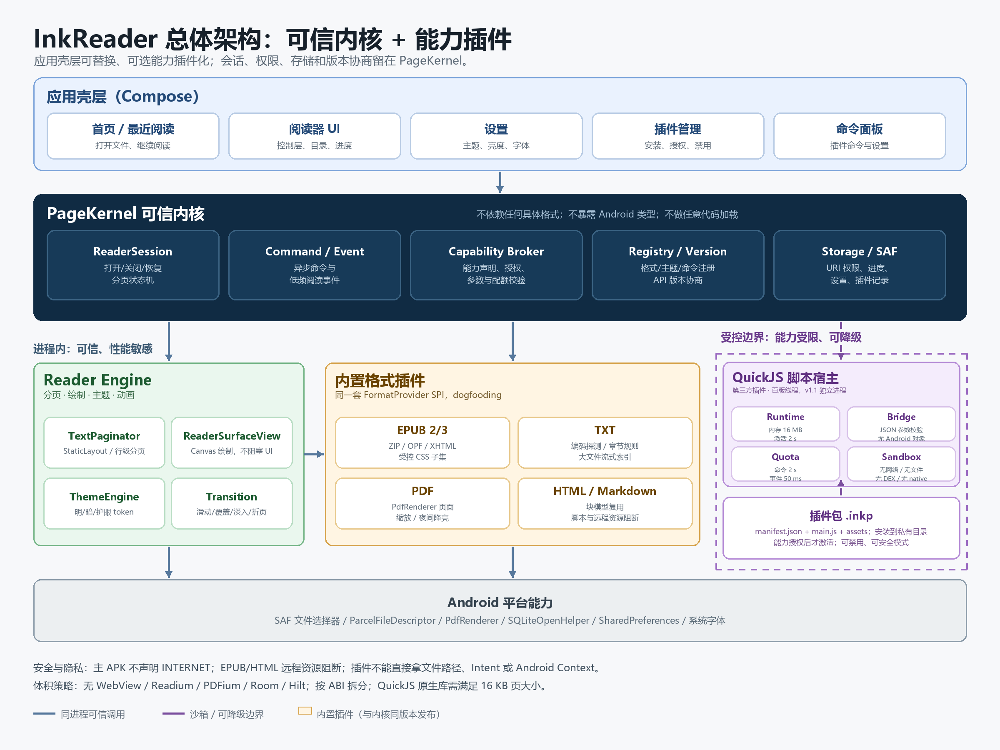
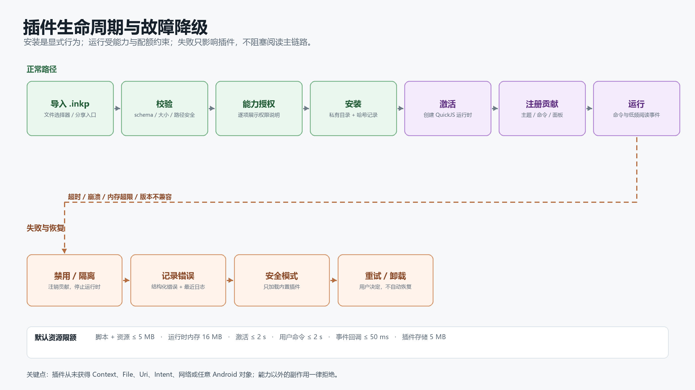

# 轻量级、插件化的 Android 本地电子书阅读器

## 技术方案与实施报告

**版本：** v1.0  
**日期：** 2026-11-05  
**项目代号：** InkReader（暂名）  
**内核代号：** PageKernel  
**报告性质：** 技术可行性与实施方案，不是已完成的软件产品

---

## 摘要

这个项目值得做，而且用原生 Android 技术完全可以做好。真正困难的并不是“把一本电子书显示出来”，而是三件事同时成立：

1. 安装包足够小、启动和翻页足够快；
2. EPUB、TXT、PDF 等格式在真实书籍上有足够好的兼容性；
3. 内核足够稳定，第三方插件可以长期扩展，但不会把阅读器本身拖垮。

本报告给出的结论是：**采用 Kotlin 原生开发，以 PageKernel 为可信内核，把格式解析、主题、命令、面板都设计成插件接口；首版第三方插件使用 QuickJS 脚本沙箱，不加载 DEX 或任意原生代码；EPUB 使用面向小说类读物的轻量重排引擎，PDF 使用系统自带的 PdfRenderer。** 这样可以在体积、性能、格式支持和扩展性之间取得现实平衡。

推荐的交付节奏不是一次性做完所有功能，而是先做一个 **2 周垂直切片**：插件宿主 + 自定义主题 + TXT 打开 + 左右翻页。这个切片能最早暴露最关键的架构风险。切片通过后，再投入 EPUB 和 PDF。

关键数字如下（均为工程预算，需在真机实测后校准）：

| 项目 | 目标 |
|---|---|
| 安装包 | arm64 单 ABI release APK ≤ 12 MB；universal APK ≤ 18 MB |
| 冷启动 | 中端机 ≤ 1 秒 |
| 翻页 | 稳定 60 fps，不出现可感知的掉帧 |
| 阅读内存 | 10 MB EPUB 场景目标 < 150 MB |
| 磁盘缓存 | 仅封面缩略图，LRU 上限 16 MB；不缓存正文和页面 |
| 网络权限 | 主 APK 不声明 INTERNET，从权限层面杜绝广告、统计和远程传书 |
| v1.0 工期 | 单人全职 18–22 周；两人 12–15 周 |
| MVP 工期 | 单人全职 10–12 周 |

**最重要的取舍：** “一切皆插件”应理解为“所有可选能力都可以以插件方式接入”，而不是“安全边界、文件权限、会话状态机也交给插件”。真正坚固的内核必须保留这些不可协商的部分，否则插件系统会变成任意代码执行和版本灾难的入口。

---

## 1. 需求理解与产品边界

### 1.1 使用场景

目标用户是希望在手机上安静阅读本地书籍的人。核心场景非常简单：

1. 从系统文件选择器中打开一本本地书；
2. 阅读，调整字体、亮度和翻页方式；
3. 下次打开时从上次位置继续；
4. 如果以后想增加功能，可以自己写插件接入，而不必修改主程序。

这个场景不需要账号、书城、云同步、社交、在线书源或广告。它也不需要“管理整个手机存储”的权限。

### 1.2 需求追溯

| 编号 | 原始要求 | 本报告的回应 | 对应章节 |
|---|---|---|---|
| R1 | 轻量级，安装包不大，运行快，切换流畅 | 原生 Kotlin；避免 WebView、Readium、PDFium 等重组件；按 ABI 分包；体积和帧率纳入 CI | 2、8 |
| R2 | 不需要远程传输和社交，只要能打开本地书籍并显示阅读 | 完全本地；SAF 读取；主 APK 无 INTERNET 权限；不做账号/同步/书城 | 1、7 |
| R3 | 支持 EPUB、TXT 等主流格式，最好支持 PDF | v1.0 支持 EPUB 2/3 重排内容、TXT、PDF、HTML、Markdown；CBZ/FB2 放 v1.1；MOBI/AZW3 等通过后续插件 | 6 |
| R4 | 运行中产生很少缓存 | 不复制书籍、不缓存正文/页面；只保留有限封面缩略图；插件独立配额；可一键清理 | 7 |
| R5 | 白天/黑夜模式、亮度调节、左右滑动和仿真翻页 | 明/暗/跟随系统主题；应用内亮度；滑动、覆盖、淡入、仿真折页四种翻页 | 5 |
| R6 | 留下外接端口，像 VS Code 一样用插件扩展，内核坚固 | PageKernel + 版本化 SPI + 声明式 UI + QuickJS 沙箱；预留外部 APK 原生插件通道；禁止主应用动态加载 DEX | 3、4 |
| R7 | 开发语言随意，请分析后选最合适 | Kotlin 原生开发；用对比表说明不选 Flutter/RN/WebView 的理由 | 2 |

### 1.3 优先级

**P0（首版必须有）**

- 本地打开、阅读、退出、恢复进度
- EPUB 2/3 重排内容、TXT、PDF 页面显示
- 明/暗模式、亮度、字号/行距/边距
- 左右滑动翻页，至少一种仿真翻页
- 最近阅读列表
- 插件内核：主题、命令、面板可扩展
- 无广告、无网络、低缓存

**P1（首版尽量有）**

- 仿真折页动画
- HTML 与 Markdown 单文件阅读
- 封面提取
- 插件安装包导入、权限确认、安全模式
- 基础无障碍支持

**P2（后续版本）**

- CBZ、FB2
- EPUB 固定版式兼容插件
- PDF 文本搜索/选择、密码 PDF 的兼容增强
- 原生插件 APK 宿主
- 用户导入字体、脚注弹窗、跨页选择

### 1.4 明确不做

v1.0 不包含以下能力。把它们排除在外，是为了让“轻量”和“稳定”真正成立，而不是把所有东西都说成“以后可以做”。

- DRM 解密、绕过版权保护
- EPUB 固定版式、脚本化 EPUB、音视频、MathML、复杂 SVG
- PDF 重排、PDF 编辑、批注、表单填写
- MOBI/AZW3、DOCX、RTF、DJVU
- TTS、听书、词典、笔记、批注、AI 摘要
- 云同步、账号、书城、在线书源、远程传书
- 插件商店、自动更新、联网下载插件
- 多端同步、阅读数据导出平台

### 1.5 设计原则

1. **Local-first**：所有阅读能力离线完成，不建立任何网络依赖。
2. **No ads, no tracking**：不申请 INTERNET 权限，不集成广告/统计 SDK。
3. **Kernel is small and boring**：内核只做状态、权限、存储、调度和协议；格式细节全部在插件侧。
4. **Everything optional is a plugin**：格式、主题、命令、面板、设置页尽量走同一注册表；内置功能也不例外。
5. **Data is immutable across boundaries**：跨插件传递只读模型，禁止把内部可变对象暴露出去。
6. **Fail safe, not fail open**：插件崩溃、超时、版本不兼容时禁用插件，阅读主链路继续可用。
7. **No dynamic DEX**：主应用不加载外部 DEX/native 代码；脚本插件是受能力约束的解释执行。
8. **Measure before optimize**：体积、启动、帧率、内存都建立基线并用 CI 守住。

### 1.6 核心矛盾

| 矛盾 | 现实影响 | 本报告的取舍 |
|---|---|---|
| 轻量 vs EPUB 兼容性 | 完整 CSS/固定版式需要浏览器级引擎，体积和内存都会上升 | 首版只做小说类重排内容；复杂书交给未来兼容插件 |
| 插件能力 vs 安全 | 任意 DEX/原生插件能力最强，但会破坏版本稳定性和安全边界 | v1 使用脚本插件 + 能力白名单；原生扩展走独立 APK 服务 |
| PDF 显示 vs PDF 高级能力 | 系统 PdfRenderer 体积最小，但没有完整的文本搜索/选择/重排 | 首版保证页面显示和缩放；高级 PDF 作为可选插件 |
| 功能多 vs 工期 | 每增加一个格式和动画，都要增加解析、测试和边界处理 | 固定 v1 范围，先把主链路做扎实 |

---

## 2. 技术选型

### 2.1 开发语言与 UI 框架

| 方案 | APK 体积 | 启动/阅读性能 | 插件扩展 | 本地文件/PDF 集成 | 结论 |
|---|---|---|---|---|---|
| **Kotlin + Android 原生** | 低到中 | 最好，能直接控制文本布局、Canvas、文件描述符 | 可设计进程内/跨进程 SPI，最容易做硬边界 | 最直接，SAF、PdfRenderer、Intent 都是一等公民 | **推荐** |
| Java + Android Views | 低 | 好 | 可行，但开发效率和类型安全较差 | 直接 | 备选，不推荐作为新项目 |
| Flutter | 高（引擎约十几 MB 起） | 好，但文本分页/文件描述符要过平台通道 | 需要同时维护 Dart 插件和原生插件两层 | 需要平台通道 | 不符合轻量目标 |
| React Native | 很高 | 一般，JS 引擎和桥接增加启动/内存开销 | JS 层扩展看似容易，实际受原生桥限制 | 需要大量原生模块 | 不推荐 |
| WebView/PWA 套壳 | 安装包可能小 | 运行时内存高，翻页和字体控制受浏览器影响 | 受 WebView 安全模型约束 | 文件访问和 PDF 体验差 | 不推荐 |
| Kotlin Multiplatform | 中 | 好 | 复杂，当前没有 iOS 需求 | 直接 | 过度设计 |

**选择 Kotlin 的核心理由：**

- 阅读器是“重交互、重排版、重文件访问”的应用，直接使用 Android 的 `StaticLayout`、`Canvas`、`ParcelFileDescriptor`、`PdfRenderer` 比跨平台桥接更可控。
- Kotlin 协程适合处理解析、布局、缩略图生成和进度写入等异步任务。
- 原生 Android 的进程、Service、Binder、签名和权限模型，正好可以用来设计插件隔离和未来的独立插件 APK。
- 不需要为了“跨平台”引入一个会显著增加安装包和内存的运行时。

### 2.2 Compose 与自定义 View 的组合

推荐组合：

- **Compose**：首页、最近阅读、设置、插件管理、命令面板、主题选择、插件声明式面板。
- **自定义 Android View（ReaderSurfaceView）**：正文分页、文本绘制、手势、页面切换动画、PDF 页面显示。

原因：

1. 正文阅读是高频绘制区。Compose 的重组和语义树会带来额外开销；自定义 View 可以用 `StaticLayout` 和 `Canvas` 精确控制每一行、每一页和每一个动画帧。
2. 仿真翻页需要直接操作双页位图、裁剪路径、阴影和绘制顺序，自定义 View 更自然。
3. 应用壳层和设置页变化频繁，Compose 的开发效率更高。
4. 两者通过 `AndroidView` 连接，边界清晰，不会让 Compose 承担阅读热路径。

这不是“为了技术而技术”。如果整个应用都用 Compose，首版也能做，但翻页/大文本布局的可控性和性能调优空间会更小；如果整个应用都用 XML View，安装包可能更小，但设置、插件表单和命令面板的开发成本会显著增加。

### 2.3 EPUB 引擎选型

| 方案 | 优点 | 缺点 | 结论 |
|---|---|---|---|
| Readium Kotlin Toolkit | EPUB 生态成熟，导航器完整 | 依赖多、包体和内存增加，WebView 导航器与自研分页/插件主题耦合较深 | 不进入 v1；作为复杂书籍兼容插件的候选 |
| 系统 WebView 渲染 | 对 CSS/固定版式兼容性最好 | 运行时内存高、WebView 缓存、插件主题难统一、离线安全边界复杂 | 不进入核心；未来可作为可选兼容插件 |
| 自研轻量重排引擎 | 体积小、行为可控、和分页/主题/插件深度整合 | 只支持 CSS 子集，复杂书会降级 | **v1 选择** |

自研引擎的边界必须说清楚：它面向**小说、散文、传记、普通非虚构读物**这类以段落文本为主的重排 EPUB。对于杂志、画册、教材、固定版式绘本，首版会给出“当前版本不支持该排版”的提示，而不是假装能完美显示。

### 2.4 PDF 引擎选型

| 方案 | 体积 | 能力 | 风险 | 结论 |
|---|---|---|---|---|
| 系统 `android.graphics.pdf.PdfRenderer` | 几乎为零 | 页面渲染、缩放、页码；高级能力受系统版本限制 | 需要 seekable FD；对不可信 PDF 建议隔离渲染 | **v1 选择** |
| AndroidX PDF | 中到高 | 文本选择、搜索、密码、注解等，但当前仍在演进 | 引入 service/依赖，和“轻量”冲突 | 作为后续可选插件 |
| Pdfium 原生库 | 高（多 ABI） | 控制力强，可做文本/搜索 | 包体、16 KB、安全维护成本 | 不进入 v1 |

首版 PDF 的目标是“能把页面稳定、清晰、可缩放地显示出来”，而不是替代专业 PDF 应用。

### 2.5 插件运行时选型

| 方案 | 插件能力 | 安全/稳定性 | 体积 | 结论 |
|---|---|---|---|---|
| **QuickJS 脚本** | 主题、命令、面板、设置、轻量文本处理 | 可限制内存/时间，无 Android API 暴露；不是军事级安全边界 | 低到中（原生库，需 16 KB 对齐） | **v1 选择** |
| Lua 脚本 | 类似，生态小一些 | 可做沙箱 | 低 | 备选 |
| 应用内加载 DEX/APK | 最强，可直接用 Android API | 动态代码加载、版本、签名、崩溃隔离风险高；与 Google Play 政策冲突风险高 | 中 | **不采用** |
| WebView 承载插件 JS | 不需要额外 JS 引擎 | 内存高、缓存、桥接面大、和 Compose 集成别扭 | 零安装包增量 | 不采用 |

QuickJS 的定位是“**可扩展的配置与轻逻辑层**”，不是“任意原生能力的替代品”。它的价值在于让主题、命令、阅读辅助、章节规则、设置面板可以快速迭代，而不必每次发版。

### 2.6 其他基础选型

| 领域 | 选择 | 理由 |
|---|---|---|
| 异步 | Kotlin Coroutines + Flow | 标准、轻量、易取消 |
| JSON | kotlinx.serialization | 编译期序列化，避免反射带来的体积/性能问题 |
| HTML/XHTML 解析 | jsoup（限 EPUB XHTML/HTML） | 对不严格 HTML 更宽容，减少自研容错成本 |
| ZIP 读取 | Apache Commons Compress | 支持基于 `SeekableByteChannel` 的随机读取，避免把整本 EPUB 复制到缓存 |
| EPUB OPF/NAV | Android `XmlPullParser` | 系统内置，体积为零；关闭外部实体 |
| 本地数据库 | `SQLiteOpenHelper` | 只有少量表，不需要 Room 的额外依赖和 KSP |
| 设置 | `SharedPreferences` 封装 | 轻量；由 `SettingsStore` 隔离实现，后续可替换 |
| 依赖注入 | 手写 AppContainer | 避免 Hilt/Koin 的体积和初始化成本 |
| 图片 | 平台 `BitmapFactory` + 手动采样 | 不引入 Coil/Glide |
| 网络 | **无** | 主 APK 不声明 INTERNET |

### 2.7 工具链基线

| 项 | 建议 |
|---|---|
| 语言 | Kotlin 2.x |
| UI | Jetpack Compose + 自定义 Canvas View |
| minSdk | 26（Android 8.0） |
| targetSdk | 36（按 2026 年 Google Play 要求；开工时复查最新要求） |
| compileSdk | 开工时最新稳定 SDK |
| JDK | 21 LTS；不要直接用当前机器上的 JDK 25 作为唯一构建 JDK |
| 构建 | Gradle Kotlin DSL + Version Catalog；AGP 最新稳定版 |
| 原生插件引擎 | QuickJS；优先评估 quickjs-kt，失败则自编译 QuickJS-ng |
| NDK | r28 或更高（16 KB 页大小默认对齐） |
| 测试 | JUnit、AndroidX Test、Macrobenchmark、Baseline Profile |
| 发布 | 按 ABI 拆分的签名 APK + 可选 universal APK |

**当前机器缺口：** 工作区目前没有 Android SDK、NDK、adb 或 Gradle；JDK 为 25。正式开工前需要安装 Android Studio、JDK 21、SDK Platform、Build Tools、Platform Tools 和 NDK r28+，并用真机验证。这个缺口不影响本报告，但会影响后续开发启动。

---

## 3. 总体架构

### 3.1 架构图



### 3.2 分层

| 层 | 模块 | 职责 |
|---|---|---|
| 应用壳层 | `:app` | 首页、阅读器 Activity、设置、插件管理、命令面板；只依赖内核 API 和已注册插件 |
| 内核 API | `:kernel-api` | 纯 Kotlin 的只读模型、SPI、能力接口、错误类型、版本常量；不依赖 Android |
| 内核实现 | `:kernel-core` | 会话状态机、插件注册表、命令/事件总线、能力代理、URI 访问、设置/进度存储、插件生命周期 |
| 阅读引擎 | `:reader-engine` | 文本测量、分页、页面模型、主题解析、绘制表面、翻页动画；通过内核 API 接收内容 |
| 内置格式插件 | `:formats:epub`、`:formats:txt`、`:formats:pdf`、`:formats:html-md` | 格式探测、解析、元数据、目录、章节内容、定位 |
| 内置能力插件 | `:builtin:themes`、`:builtin:transitions`、`:builtin:commands` | 通过公开 SPI 注册默认主题、翻页模式和命令，验证插件 API 可用 |
| 脚本宿主 | `:plugin-host-quickjs` | QuickJS 生命周期、JS↔Kotlin 桥、能力校验、超时/内存限制、插件日志 |
| 开发 SDK | `:sdk`、`docs/plugin-sdk` | TypeScript 类型、manifest schema、示例插件、API 文档 |
| 性能基准 | `:benchmark` | 启动、翻页、内存、体积回归，不进入 release APK |

### 3.3 依赖规则

```text
app ───────────────► kernel-api
 │                        ▲
 │                        │
 ├──► formats/* ──────────┤
 ├──► builtin/* ──────────┤
 └──► plugin-host ────────┘

kernel-core ──► kernel-api
reader-engine ──► kernel-api
formats/* ──► kernel-api + reader-engine model
```

硬性规则：

- `kernel-api` 不依赖 Android，保证测试简单、边界清晰。
- `kernel-core` 不出现 EPUB、PDF、TXT 的具体类名。
- 内置格式插件也只依赖公开 SPI；内核不能对某个格式开后门。
- 插件不得直接依赖 `kernel-core`，只能依赖 `kernel-api`。
- 阅读引擎不直接读取 URI；所有内容通过内置格式插件产出的只读文档模型进入。
- 任何跨插件/跨进程数据都必须可序列化、不可变、可版本化。

### 3.4 打开一本书的数据流

1. 用户在系统文件选择器中选择文件，或者从文件管理器用“打开方式”传入 URI。
2. 内核通过 `ContentResolver` 获取 `ParcelFileDescriptor` 和可读的 `SeekableSource`；尝试持久化读取权限。
3. 格式注册表按“魔数 + 扩展名 + MIME”依次探测；例如 ZIP + `META-INF/container.xml` 识别为 EPUB，`%PDF-` 识别为 PDF。
4. 匹配的格式插件解析元数据、目录和章节结构，产出只读 `BookDocument`。
5. 内核创建 `ReaderSession`，恢复上次的 `Locator`。
6. 阅读引擎按当前主题、字号、屏幕尺寸进行分页；当前章节和相邻章节按优先级布局。
7. 渲染表面绘制页面；翻页动作更新 `Locator`。
8. 进度以节流方式写入 SQLite；应用退到后台时强制落盘一次。
9. 关闭会话时释放解析器、PdfRenderer、位图和文件描述符。

### 3.5 线程与进程模型

| 工作 | 位置 | 原因 |
|---|---|---|
| Compose UI、手势、动画 | 主线程 | 必须在 16.7 ms 帧预算内完成 |
| 文件读取、格式解析、封面解码 | IO/Default 协程 | 避免阻塞 UI |
| 文本分页/测量 | 专用单线程布局调度器 | 避免并发布局互相踩踏；按会话串行 |
| PDF 页面渲染 | 专用渲染线程 | PDF 只允许一次打开一个页面，必须串行 |
| 进度/数据库写入 | IO | 节流后写入，不阻塞翻页 |
| 第三方 JS 插件 | 专用插件线程；v1.1 迁移到独立进程 | 避免插件死循环/崩溃直接拖垮主进程；公共 API 从第一天就设计成异步/JSON，可平移 |
| 内置插件 | 主进程 | 可信、性能敏感、与内核同版本发布 |

**关于进程隔离的诚实说明：** v1.0 计划先把第三方脚本宿主放在独立的工作线程中，并把宿主边界设计成可迁移的异步消息接口；v1.1 再迁移到独立 `:plugin` 进程。这样不会为了“看起来更安全”而在首版同时承担 IPC、状态同步、进程重建和脚本调试的全部复杂度。对于恶意插件，脚本沙箱不是绝对安全边界；插件的信任模型在 4.8 节明确说明。

### 3.6 生命周期与恢复

- **旋转/分屏**：保存 `Locator` + 主题/字号快照，重建 View 后按新尺寸重新分页，定位到最近的字符偏移。
- **进程被系统回收**：URI 如果已持久化，可直接恢复；否则提示用户重新选择文件，不假装“文件还在”。
- **文件被移动或删除**：捕获 `SecurityException`/`FileNotFoundException`，标记最近记录失效，提供重新选择。
- **插件升级**：先安装到新目录，验证通过后原子切换；失败保留旧版本。
- **安全模式**：连续崩溃或启动超时的第三方插件自动禁用；用户也可以通过长按“打开”或专门的启动入口进入安全模式。
- **低内存**：`onTrimMemory` 时释放相邻章节布局和非当前页位图，保留下当前页和进度。

---

## 4. 插件内核设计

这是本项目最重要的部分。插件系统做错，后面所有功能都会变成技术债；插件系统做对，格式、主题和交互可以持续生长。

### 4.1 内核职责与非职责

**内核负责：**

- 打开/关闭会话、当前书籍与定位状态
- 文件访问、URI 权限、基本安全校验
- 插件注册、启用/禁用、版本协商、能力授权
- 命令与事件路由
- 设置、进度、插件安装记录的持久化
- 线程/进程边界、超时、配额、日志、故障降级
- 公开 API 的兼容性测试

**内核不负责：**

- EPUB 的 ZIP/OPF/XHTML 细节
- PDF 的页面渲染细节
- 具体主题、字体、翻页视觉实现
- 第三方插件的业务逻辑
- 任意插件 UI 的直接渲染

### 4.2 公开 API 的设计约束

1. **不暴露 Android 类型**：插件 API 中不出现 `Context`、`Uri`、`File`、`View`、`Intent`、`ParcelFileDescriptor`。
2. **只读模型**：跨边界传递的都是不可变数据类/JSON，插件不能拿到内核内部可变对象。
3. **能力换资源**：插件不能直接读文件；要读当前章节的文本，必须声明并获批 `book.text.read` 能力。
4. **异步优先**：命令、事件、数据读取都是 suspend/异步消息，方便未来从线程迁移到进程。
5. **版本显式**：manifest 声明 `minHostApi`/`targetHostApi`；内核不认识的主版本直接拒绝。
6. **失败隔离**：插件异常、超时、内存超限都转换为结构化错误，不影响阅读会话。
7. **最小表面**：API 宁可少而稳，也不要为了“什么都能做”而暴露内部实现。

### 4.3 核心 SPI

以下是 Kotlin 侧的示意，不是最终签名。公开 SDK 会单独生成类型定义和 API 文档。

```kotlin
interface FormatProvider {
    val id: String
    suspend fun probe(source: BookSource): FormatMatch?
    suspend fun open(source: BookSource, context: OpenContext): BookDocument
}

interface ThemeProvider {
    fun themes(): List<ReaderTheme>
}

interface CommandProvider {
    fun commands(): List<ReaderCommand>
}

interface PanelProvider {
    fun panels(slot: ReaderSlot): List<PanelDescriptor>
}

interface ReaderHook {
    suspend fun onEvent(event: ReaderEvent, context: HookContext)
}

data class BookDocument(
    val metadata: BookMetadata,
    val layout: LayoutKind,          // Reflowable | FixedPage
    val spine: List<SpineItem>,
    val toc: List<TocEntry>,
    val locatorCodec: LocatorCodec
)
```

内置插件与第三方 JS 插件的关系：

- 对外公开的是**能力受限的 JSON 协议**；
- 对内，内置格式/主题插件使用同一套 SPI 的 Kotlin 版本；
- 脚本宿主只映射 SPI 的一个安全子集，不映射内核内部对象。

### 4.4 扩展点与版本边界

| 扩展点 | v1.0 内置 | v1.0 第三方 JS | 未来原生通道 |
|---|---|---|---|
| 格式解析 | EPUB/TXT/PDF/HTML/MD | 轻量文本格式（受大小限制） | v2 外部插件 APK |
| 主题 | 默认明/暗/护眼 | 支持 | 不需要 |
| 命令 | 目录、进度、设置等 | 支持 | 可扩展 |
| 阅读器面板 | 顶部/底部槽位 | 支持声明式节点 | 可扩展 |
| 设置页 | 内置设置 | 支持声明式字段 | 可扩展 |
| 章节识别规则 | TXT 默认规则 | 支持 | 不需要 |
| 页面渲染/动画 | 内置 | **不支持** | v2 原生插件 |
| 网络能力 | 无 | **无** | 默认禁止，需重新设计安全模型 |

这张表是承诺边界。首版不会声称“任何插件都能做任何事”，但会保证内核的接口不是一次性的：脚本宿主、未来独立进程和外部 APK 服务都可以复用同一套模型与命令语义。

### 4.5 插件包格式

插件是一个 ZIP 包，扩展名为 `.inkp`（暂定）：

```text
my-plugin.inkp
├── manifest.json
├── main.js
├── assets/
│   └── cover.png
└── README.md
```

`manifest.json` 示例：

```json
{
  "schemaVersion": 1,
  "id": "dev.example.papertheme",
  "name": "Paper Theme",
  "version": "1.0.0",
  "author": "You",
  "description": "A warm paper theme with reading-time badge.",
  "entry": "main.js",
  "api": {
    "minHostApi": 1,
    "targetHostApi": 1
  },
  "capabilities": [
    "reader.state.read",
    "theme.contribute",
    "command.contribute",
    "settings.readwrite",
    "storage.plugin"
  ],
  "contributes": {
    "settings": "settings.json"
  }
}
```

安装校验至少包括：

- manifest schema、ID 格式、版本号、entry 路径合法；
- 路径不能穿越插件目录，不接受符号链接；
- 文件数量、解压后大小、单文件大小、压缩比有上限；
- 只允许预期类型的资源，不允许 `.so`、`.dex`、`.jar`；
- 插件 ID + 版本唯一；升级包不能静默替换另一个插件；
- 首次启用时展示能力清单，用户明确同意。

### 4.6 插件生命周期



1. **导入**：用户从文件选择器选择 `.inkp`。
2. **校验**：结构、manifest、大小、能力、签名（可选）。
3. **授权**：展示“读当前书籍状态 / 注册主题 / 写入插件存储”等能力说明。
4. **安装**：复制到应用私有目录，记录哈希、版本和启用状态。
5. **激活**：创建独立 QuickJS 运行时，执行 `main.js`，收集贡献；设置超时。
6. **运行**：命令和事件通过异步消息进入；每个调用有超时、内存和频率限制。
7. **降级**：异常/超时被捕获并记入插件日志；连续失败自动禁用。
8. **卸载**：注销贡献、停止运行时、删除插件私有存储；不触碰用户书籍。
9. **安全模式**：启动时只加载内置插件，给用户一个恢复入口。

### 4.7 QuickJS 桥接与资源限制

建议的默认限制（可按设备性能调整）：

| 限制 | 默认值 |
|---|---|
| manifest + 脚本 + 资源总大小 | ≤ 5 MB |
| 单个 JS 文件 | ≤ 1 MB |
| 单插件运行时内存 | 16 MB |
| 激活时间 | ≤ 2 秒 |
| UI 钩子/事件回调 | ≤ 50 ms，超时即丢弃该事件 |
| 用户主动命令 | ≤ 2 秒，超时返回错误 |
| 插件私有存储 | 5 MB |
| 事件频率 | 每 100 ms 合并一次，不允许逐帧回调 |
| 日志 | 环形缓冲，最多 200 条/插件 |

桥的设计要点：

- JS 侧没有 `fetch`、`XMLHttpRequest`、文件系统、Android 对象、反射。
- JS 只能调用宿主提供的 JSON 函数，例如 `ink.reader.getState()`、`ink.commands.register()`。
- 宿主对每个参数做 schema 校验，拒绝超长字符串、未知字段和非法枚举。
- 不允许插件在绘制线程/主线程执行；所有插件调用进入专用线程队列。
- 不能在插件回调里同步等待 UI；所有结果通过消息返回。
- 插件卸载/重载时取消所有未完成调用。

### 4.8 信任模型

必须把这句话写清楚：**QuickJS 沙箱的主要目标是可靠性和降低误操作风险，不是抵御国家级攻击者的绝对安全边界。**

首版建议的信任模型：

- 插件由用户自己编写或从可信来源获取，安装是显式行为；
- 主 APK 无 INTERNET 权限，插件无法通过网络外传数据；
- 插件只能通过能力接口拿到当前书籍的最小必要信息；
- 插件运行在专用线程，v1.1 迁移独立进程，避免崩溃拖垮主程序；
- 不在插件中暴露任意文件路径；
- 如果用户安装不可信插件，仍存在引擎漏洞或逻辑越权的风险，安装界面会明确提示。

这与 VS Code 的现实类似：扩展默认不是“绝对安全”的，市场、签名、权限和用户判断共同构成防线。我们不能承诺一个无法验证的“绝对安全沙箱”。

### 4.9 版本兼容策略

- API 主版本：不兼容变更。内核只加载主版本匹配的插件。
- API 次版本：只增不改。新增可选能力，旧插件继续可用。
- 补丁版本：不改变语义。
- `minHostApi` / `targetHostApi` 决定可运行范围；超出范围拒绝激活，并给出明确提示。
- 公开 API 至少保留两个次版本的弃用期；弃用项先警告、后移除。
- 每个 API 版本维护一组“契约测试插件”，升级内核时必须通过。
- 插件升级失败时保留旧版本，避免用户失去可用功能。

### 4.10 声明式 UI，而不是任意 UI

v1 的插件 UI 只允许声明式节点，例如：

```json
{
  "type": "column",
  "children": [
    {"type": "text", "value": "阅读进度", "style": "caption"},
    {"type": "progress", "value": 0.42},
    {"type": "button", "label": "跳到本章开头", "command": "chapter.start"}
  ]
}
```

可用节点限制在文本、按钮、开关、滑块、下拉、进度条、分隔线和容器。这样做的原因：

- 插件 UI 不会绑定 Compose/View 的版本，内核升级不破坏插件；
- 插件无法注入任意 View、WebView 或脚本；
- 主题和安全边界容易统一；
- 首版开发量可控。

代价是插件不能做完全自定义的阅读界面。对于首版，这是正确的取舍；真正需要自绘 UI 的扩展，应走未来的原生插件通道，而不是在脚本层打开一个任意渲染口子。

### 4.11 命令与事件

初始命令：

- `reader.open`
- `reader.close`
- `reader.nextPage` / `reader.prevPage`
- `reader.goToChapter`
- `reader.goToLocator`
- `reader.setTheme`
- `reader.toggleControls`
- `plugin.list` / `plugin.setEnabled`
- `app.openSettings`

初始事件：

- `book.opened`
- `book.closed`
- `page.changed`
- `chapter.changed`
- `theme.changed`
- `reader.paused`
- `reader.resumed`

不允许每帧事件，不允许插件阻塞翻页。命令和事件都带会话 ID，防止旧会话的异步结果污染新书。

### 4.12 原生扩展通道（v2 预留）

如果未来需要高性能格式解析、PDF 引擎或自定义页面效果，推荐路径不是在主应用里加载 DEX，而是：

1. 开发一个独立插件 APK；
2. 插件 APK 暴露一个带签名校验的 Service（AIDL）；
3. 主应用通过 Binder 调用，插件在自己的进程中运行；
4. 大块数据通过共享内存/临时文件描述符传输，不挤占 Binder 事务；
5. 插件 APK 需要用户显式安装和授权；主应用只连接白名单签名。

优势：

- 主应用不加载外部代码，降低动态代码加载风险；
- 插件崩溃/内存泄漏由独立进程承担；
- 插件可以使用 Android 原生能力，但权限由独立 APK 声明；
- 和 Play 政策的关系更清晰。

代价：需要维护 AIDL 兼容性、Binder 数据传输和插件安装体验。因此放在 v2，而不是 v1。

### 4.13 借鉴 VS Code 的概念映射

| VS Code | InkReader |
|---|---|
| `package.json` 的 `contributes` | `manifest.json` 的 `contributes` |
| Extension Host（独立进程） | QuickJS 插件宿主（先线程，后独立进程） |
| `vscode` API | `ink` API |
| Command Palette | 阅读器命令面板 |
| Views / TreeView | 声明式阅读器面板 |
| Color Theme | 阅读主题 |
| Extension activation events | 阅读器生命周期事件 |
| `engines.vscode` | `api.minHostApi` / `api.targetHostApi` |
| Extension marketplace | v1 不做；从本地 `.inkp` 安装 |

“像 VS Code”不代表要复制它的所有复杂度，而是借鉴它的**清单声明、能力 API、独立宿主、版本协商和故障隔离**。

### 4.14 示例插件：阅读进度徽章

```javascript
// main.js
export function activate(ink) {
  ink.commands.register({
    id: "reading.progressBadge",
    title: "显示阅读进度徽章",
    run: async () => {
      const state = await ink.reader.getState();
      ink.ui.setBadge(`${Math.round(state.progress * 100)}%`);
    }
  });

  ink.events.on("page.changed", async (event) => {
    ink.ui.setBadge(`${Math.round(event.progress * 100)}%`);
  });
}
```

这个例子刻意只使用低频事件和最小状态读取，不暴露逐帧能力。

### 4.15 “一切皆插件”的边界

以下部分**不插件化**：

- 文件访问与 URI 权限
- 会话状态机
- 插件注册/版本/安全策略
- 存储与进度一致性
- 主界面导航和崩溃恢复

以下部分**插件化或以插件方式组织**：

- 格式解析
- 主题与排版 token
- 命令
- 面板
- 设置分区
- TXT 章节识别规则
- 未来的原生格式/渲染扩展

这个边界是“硬内核”的真正含义：不是让所有代码都变成插件，而是让内核只保留不可替代的部分。

---

## 5. 阅读引擎

### 5.1 文档模型

阅读引擎接收两类文档：

- **Reflowable**：EPUB、TXT、HTML、Markdown，按屏幕宽度重新排版；
- **FixedPage**：PDF，按页面尺寸缩放显示。

重排文档统一转换为块模型：

```text
Chapter
 └── Block[]
      ├── Paragraph(inlines)
      ├── Heading(level, inlines)
      ├── Quote(blocks)
      ├── ListBlock(ordered, items)
      ├── Image(src, width, height, alt)
      ├── Rule
      ├── CodeBlock(text)
      └── TableLite(rows)
```

内联样式只支持阅读必需的部分：粗体、斜体、下划线、删除线、行内代码、链接、脚注引用、Ruby（后续）。不支持任意 CSS 盒模型和脚本。

### 5.2 分页算法

1. 根据主题得到 `TextPaint`：字体、字号、行距、字重、字距、颜色。
2. 根据页面尺寸、边距、页眉页脚占用计算可用宽高。
3. 对每个 Block 创建 `StaticLayout`，得到行数和每行度量。
4. 按行把内容装入页面；图片按可用宽度缩放，超高图片单独占页或分页显示。
5. 页尾避免孤行（可选），段落间距和首行缩进进入布局。
6. 输出 `PageSlice`：章节 ID、块范围、行范围、绘制偏移。
7. 只为当前章节和相邻章节保留布局；其他章节的布局释放。

不采用“先给整本书算页数”的做法。那会让大文件打开变慢、内存不可控，而且字号一改就全部失效。页码只在当前章节内精确显示，整本书显示百分比；进度以稳定字符定位为主，不依赖页码。

### 5.3 渲染表面

`ReaderSurfaceView` 负责：

- 绘制当前页的 `StaticLayout`、图片、页眉页脚；
- 处理左右滑动、点击区域、长按菜单；
- 预渲染相邻页位图，用于翻页动画；
- 在 `onTrimMemory` 时释放非必要位图；
- 不在 `onDraw` 中分配对象、解析文件或查询数据库。

建议把一页绘制到离屏 Bitmap，动画期间只做位图变换。这样滑动/折页时不需要重复排版。

### 5.4 定位与进度

统一使用可版本化的 `Locator`：

```json
{
  "version": 1,
  "chapter": 12,
  "block": 48,
  "charOffset": 716,
  "pdfPage": null
}
```

- TXT：章节索引 + 字符偏移；
- EPUB：spine 索引 + 块索引 + 字符偏移；
- PDF：页码 + 页面内缩放/滚动偏移（可选）。
- 进度百分比 = 已读字符/总字符的归一化估算；不等同于“页数百分比”。
- 恢复时优先匹配字符位置；定位失败则退到章节开头，不能丢书签式进度。

### 5.5 主题与排版

| Token | 示例 |
|---|---|
| 背景色 | 日间 `#FAF7F0`，夜间 `#121212` |
| 正文色 | 日间 `#2A2A2A`，夜间 `#C9C9C9` |
| 强调色 | 可插件覆盖 |
| 字体 | 系统无衬线/衬线/等宽；不内置中文字体 |
| 字号 | 14–36 sp |
| 行距 | 1.2–2.0 倍 |
| 边距 | 左右 12–48 dp |
| 段间距 | 0–1.5 倍行高 |
| 首行缩进 | 0 或 2 em |
| 对齐 | 左对齐/两端对齐 |
| 页眉页脚 | 时间、章节、进度；可关闭 |

不在 APK 中捆绑中文字体，原因很直接：一个完整中文字体通常会增加数 MB 到十几 MB，与轻量目标冲突。首版使用系统字体；未来的字体插件可以自带字体，但必须单独计入包体和内存。

### 5.6 亮度与日夜模式

- 主题：日间、夜间、跟随系统；可增加护眼/羊皮纸主题，但不作为卖点。
- 亮度：使用当前窗口的 `screenBrightness`，0.01–1.0；默认“跟随系统”。
- 不申请修改系统亮度的权限，不影响其他应用。
- 部分设备/系统对窗口亮度支持不一致，提供可选的黑色遮罩作为兜底。
- PDF 夜间模式默认使用“降低亮度”而不是全量反色；全量反色会导致图片/图表变成负片。用户可显式开启反色。
- 阅读时可选“保持屏幕常亮”，使用 `FLAG_KEEP_SCREEN_ON`，不申请 wake lock。

### 5.7 翻页模式

| 模式 | 行为 | 复杂度 | 备注 |
|---|---|---|---|
| 左右滑动（默认） | 跟手水平移动，松手吸附 | 低 | 最稳定、最省电 |
| 覆盖 | 新页从右侧覆盖旧页，阴影表达层次 | 中 | 接近纸质书 |
| 淡入淡出 | 双页淡入切换 | 低 | 低端机友好 |
| 仿真折页 | 折线跟随手指，裁剪当前/下一页，阴影渐变 | 高 | v1 做简化 2D 折页，不做全物理模拟 |
| 上下滚动 | 连续垂直滚动 | 中 | 可选，不属于“翻页” |

**仿真折页的边界：** 首版目标是“视觉上像纸张折起”，不是完整 3D 网格变形。使用 Canvas 裁剪、路径和渐变阴影，预渲染两页位图；低端机如果帧率不足，自动降级为覆盖/滑动。自定义折页插件在 v1 不开放，避免插件直接接管渲染热路径。

### 5.8 交互

- 点击屏幕左/右 1/3：上一页/下一页；
- 点击中间：呼出/隐藏控制层；
- 横向滑动：翻页；
- 双指缩放：仅 PDF 和图片；
- 长按：选择文字（首版仅 EPUB/TXT 的段落级支持；完整选择在 v1.1 评估）；
- 系统返回：先关闭控制层，再退出阅读器；
- 音量键翻页：可选，默认关闭。

### 5.9 无障碍

首版保证：

- 所有按钮/滑块/开关有内容描述；
- 支持系统字体缩放；
- 不只靠颜色表达状态；
- 提供“减少动态效果”，关闭折页动画；
- 正文区域至少暴露当前页文本的语义节点。

完整的逐行朗读/选择导航放在 v1.1，不在首版夸大无障碍完整性。

### 5.10 边界情况

- 超长章节：按块分批布局，禁止一次性创建超大全章 Bitmap；
- 巨大图片：按屏幕尺寸采样，设置最大像素数，防止 OOM；
- 缺失字体：回退到系统字体，记录警告但不崩溃；
- 乱码 TXT：允许手动切换编码；
- 损坏 EPUB：定位到具体错误（ZIP、OPF、XHTML），给用户可理解的提示；
- 非 seekable 文件描述符：提示并提供一次临时复制，关闭时删除；
- 低内存：释放相邻章节和位图，保留当前页与 Locator；
- 屏幕旋转/分屏：重新分页并定位到最近字符；
- 权限丢失：标记最近记录不可用，要求重新选择。

---

## 6. 格式支持

### 6.1 支持矩阵

| 格式 | v1.0 | 说明 |
|---|---|---|
| EPUB 2.0/3.x（重排） | ✅ 核心 | 元数据、目录、章节、图片、基本 CSS、封面、内部链接；不支持 DRM、固定版式、脚本、音视频 |
| TXT | ✅ 核心 | UTF-8/UTF-16/GB18030/Big5 检测；BOM；自动章节；大文件索引 |
| PDF | ✅ 核心 | 页面渲染、缩放、页码、夜间降亮；不支持文本搜索/选择/重排/批注 |
| HTML | ✅ 核心（单文件） | 去除脚本，阻止远程资源；样式受限 |
| Markdown | ✅ 核心（子集） | 标题、段落、列表、引用、代码块、图片（内联/本地可用时） |
| CBZ | 🔜 v1.1 | ZIP 图片合集，适合漫画；需要图片排序和双页模式 |
| FB2 | 🔜 v1.1 | XML 格式，映射到重排块模型 |
| MOBI / AZW3 | 插件/后续 | Kindle 私有结构复杂；不作为核心 |
| DOCX / RTF | 插件/后续 | 文档型，不是阅读器首版重点 |
| EPUB 固定版式 | 后续兼容插件 | 需要 WebView/专门布局引擎，和轻量核心冲突 |
| DJVU | 不做 | 小众，渲染/解析成本高 |

### 6.2 EPUB

处理链路：

1. 检查 ZIP 结构和 `mimetype`；
2. 读 `META-INF/container.xml`，定位 OPF；
3. 解析 OPF：元数据、manifest、spine、cover；
4. 读 EPUB 3 nav 或 EPUB 2 NCX 生成目录；
5. 按 spine 顺序解析 XHTML 内容文档；
6. XHTML → 块模型：段落、标题、列表、引用、图片、链接、脚注；
7. 应用受控 CSS 子集；
8. 解析相对 URL，只允许容器内资源；
9. 生成 `BookDocument`。

支持的 CSS 子集（首版）：

- `font-weight`、`font-style`、`text-decoration`
- `text-align`、`text-indent`
- `margin`、`padding`（受限）
- `line-height`
- `font-size`（映射到主题字号范围）
- 图片 `width`/`height`/`max-width`
- 列表样式的基础映射

明确忽略：定位、浮动、grid/flex、复杂伪元素、动画、外部字体、远程资源、脚本、iframe、object、音视频。遇到固定版式或 DRM 的书，显示明确的不支持说明，不尝试“部分渲染”导致更糟的阅读体验。

安全措施：

- 禁用 XML 外部实体（XXE）；
- 限制 XML 深度和单文档大小；
- ZIP 路径穿越防护；
- 压缩比/总解压大小限制；
- 图片尺寸/解码内存上限；
- 不执行 EPUB 内脚本，不访问网络。

### 6.3 TXT

TXT 看似简单，实际最容易出现“打开是乱码”和“几百 MB 卡死”。

处理策略：

1. 先读 BOM 和前 64 KB 采样；
2. 优先严格 UTF-8 解码；
3. 失败后尝试 UTF-16、GB18030、Big5；
4. 仍失败则显示“编码选择”，不要静默输出乱码；
5. 扫描章节标题，建立字节/字符偏移索引；
6. 按块读取，不把整本文件读进内存；
7. 章节标题正则支持：
   - `第[一二三四五六七八九十百千万零〇0-9]+[章节回卷部篇]`
   - `Chapter\s+\d+`
   - `序章`、`楔子`、`后记`、`尾声`
8. 允许插件覆盖章节识别规则；
9. 用户手动跳转/恢复时只解压目标区间。

大文件目标：

- 100 MB TXT 能打开，首屏 < 2 秒；
- 不在主线程做全文扫描；
- 索引可丢弃，重新扫描可恢复；
- 不落盘生成全文缓存。

### 6.4 PDF

首版流程：

1. 通过 SAF 取得 seekable `ParcelFileDescriptor`；
2. 用 `PdfRenderer` 打开；
3. 按适配宽度渲染当前页到 Bitmap；
4. 缩放时先缩放位图，停止手势后再按新尺寸重渲染当前页；
5. 夜间模式默认降低亮度，可选反色；
6. 页码、缩放比例、滚动位置进入 Locator；
7. 关闭时释放 Page/Renderer/FD。

限制：

- 不提取文本，因此不承诺搜索、选择、复制；
- 不重排；
- 不填写表单；
- 加密 PDF 在旧系统上可能无法打开；Android 15+ 可通过 `LoadParams` 尝试支持，失败要给出可理解提示；
- 大页面按屏幕尺寸降采样，避免单页位图 OOM；
- 非 seekable 的 provider 先临时复制，退出即删除，并提示“该文件源不支持直接读取”。

`PdfRenderer` 的官方文档建议对不可信文件使用隔离进程。首版为了控制复杂度在同进程渲染，并在报告的风险章节明确这一残余风险；对于不可信/高风险 PDF，未来应通过独立渲染服务或原生 PDF 插件处理。

### 6.5 HTML 与 Markdown

HTML：

- 支持单文件 HTML；
- 移除脚本、iframe、object；
- 远程图片/CSS 一律阻止；
- 本地相对资源在 SAF 单文件场景通常不可访问，提示用户资源可能缺失；
- 使用与 EPUB 相同的块模型和 CSS 子集。

Markdown：

- 标题、段落、强调、列表、引用、代码块、分隔线、链接；
- 图片：内联 data URI 或可访问的本地资源；远程图片阻止；
- 不实现完整 CommonMark 扩展和 HTML 内嵌。

### 6.6 格式探测与错误提示

格式探测优先级：

1. 魔数：PDF `%PDF-`，ZIP `PK\x03\x04`；
2. ZIP 内部结构：`mimetype=application/epub+zip`、`META-INF/container.xml`；
3. MIME type（仅作参考，很多文件管理器返回 `application/octet-stream`）；
4. 扩展名（最后兜底）。

错误提示示例：

- “这不是有效的 EPUB：缺少 META-INF/container.xml。”
- “这本 PDF 需要密码，当前系统版本不支持输入密码。”
- “文件太大或压缩结构异常，已停止解析以保护设备。”
- “这本 EPUB 使用了固定版式，v1.0 暂不支持。”

用户看到的是可行动的信息，不是堆栈。

---

## 7. 存储、缓存与隐私

### 7.1 文件访问

- 使用 Storage Access Framework 的 `ACTION_OPEN_DOCUMENT` 和 `ACTION_VIEW` Intent。
- 申请 `takePersistableUriPermission`，仅保留读取权限。
- 不申请 `READ_EXTERNAL_STORAGE`、`MANAGE_EXTERNAL_STORAGE` 或媒体权限。
- 不扫描整个存储，不做全盘书库索引。
- 最近阅读只保存用户主动打开的书，最多保留 100 条。

### 7.2 数据模型

SQLite（单文件，`SQLiteOpenHelper`）核心表：

```sql
CREATE TABLE books (
  id TEXT PRIMARY KEY,
  uri TEXT NOT NULL,
  display_name TEXT NOT NULL,
  mime TEXT,
  format TEXT NOT NULL,
  title TEXT,
  author TEXT,
  cover_path TEXT,
  added_at INTEGER NOT NULL,
  last_opened_at INTEGER,
  locator_json TEXT,
  progress REAL DEFAULT 0
);

CREATE TABLE plugins (
  id TEXT PRIMARY KEY,
  version TEXT NOT NULL,
  enabled INTEGER NOT NULL DEFAULT 0,
  installed_at INTEGER NOT NULL,
  manifest_json TEXT NOT NULL,
  last_error TEXT
);
```

设置使用 `SharedPreferences`：主题、字号、行距、边距、翻页模式、亮度、全屏、保持常亮等。插件设置存放在插件私有目录，由内核做 schema 校验和配额限制。

### 7.3 缓存策略

| 数据 | 位置 | 上限/策略 |
|---|---|---|
| 书籍正文/页面 | 不缓存 | 每次从源文件按需读取 |
| 封面缩略图 | `cacheDir/covers` | LRU，≤16 MB；可关闭/清理 |
| 当前/相邻页位图 | 内存 | 最多 3 页或固定内存预算；低内存释放 |
| PDF 非 seekable 临时文件 | `cacheDir/pdf-spool` | 仅当前会话，关闭即删；提示用户 |
| 插件代码/资源 | `filesDir/plugins/<id>/<version>` | 非缓存，属于安装数据；卸载清除 |
| 插件私有数据 | `filesDir/plugin-data/<id>` | 每插件 5 MB 配额 |
| 日志 | 内存环形缓冲 | 默认不落盘；可手动导出 |

不引入 WebView，因此没有 WebView 缓存、Cookie、localStorage 等隐性数据。这不是“尽量少”，而是从架构上消除一大类缓存和隐私问题。

### 7.4 网络、广告与统计

- 主 APK 的 `AndroidManifest.xml` **不声明** `android.permission.INTERNET`。
- 不集成广告 SDK、崩溃统计 SDK、埋点 SDK。
- 不请求账号、通讯录、位置、设备标识。
- EPUB/HTML/Markdown 中的远程资源一律阻止；外部链接仅复制或交给用户明确操作。
- 不设“检查更新”网络请求；版本更新由用户手动安装 APK。
- 如果未来某个插件需要联网，必须重新设计权限模型并解释安全影响；默认不提供。

### 7.5 备份与卸载

- `android:allowBackup="false"`，避免把 URI、插件和进度自动备份到云端。
- 卸载应用会清除数据库、封面缓存和插件；不会删除用户原始书籍。
- 提供“清除缓存”和“清除阅读记录”；清除记录不删除书籍文件。
- 应用私有目录不导出；插件无法拿到任意路径。

---

## 8. 性能与安装包预算

### 8.1 体积拆解（arm64 单 ABI，估算）

| 组成 | 估算 |
|---|---|
| Kotlin/AndroidX 基础 | 1.5–2.5 MB |
| Compose UI + Material3 | 3–5 MB |
| QuickJS 原生库（arm64） | 1–2 MB |
| jsoup + Commons Compress + serialization | 1–1.5 MB |
| 应用代码与资源 | 1–2 MB |
| **预计 release APK** | **8–12 MB** |

universal APK 会额外包含 armeabi-v7a/x86_64 的原生库，预计 12–18 MB。实际数字用 APK Analyzer 和 CI 体积报告校准。

### 8.2 优化手段

- R8 代码压缩、资源压缩、未使用资源移除。
- ABI 拆分：主推 arm64-v8a；为旧设备提供 armeabi-v7a；x86_64 仅供模拟器。
- 不引入 WebView、Readium、PDFium、Room、Hilt、OkHttp、Coil、Glide。
- 不捆绑中文字体。
- Baseline Profile + ProfileInstaller，改善首次启动和滚动/翻页。
- 插件延迟初始化：首帧之后再加载外部插件清单和运行时。
- 封面按需生成，限制尺寸，使用 RGB_565 或合适的采样。
- 避免反射式序列化；使用 kotlinx.serialization。
- 不在 `onDraw` 分配对象；位图复用；布局缓存有明确上限。
- 用 `zipalign -c -P 16 -v 4` 检查 16 KB 对齐。

### 8.3 性能预算

| 指标 | 目标 | 测量方式 |
|---|---|---|
| 冷启动 | ≤ 1.0 s（中端机） | Macrobenchmark |
| 打开 10 MB EPUB 首屏 | ≤ 1.5 s | 插桩计时 |
| 翻页 | 60 fps，P95 帧耗时 < 16.7 ms | Perfetto/JankStats |
| 100 MB TXT 首屏 | ≤ 2 s | 插桩计时 |
| 内存 | 10 MB EPUB < 150 MB | Android Studio Profiler / dumpsys |
| APK | arm64 ≤ 12 MB | APK Analyzer |
| 崩溃率 | 内部测试 0 个 P0 崩溃 | 测试矩阵 |
| 缓存 | 封面 ≤16 MB，无正文缓存 | 文件系统检查 |

低端机策略：

- 默认关闭仿真折页，改用滑动/淡入；
- 缩小预渲染页数；
- 降低图片解码尺寸；
- 降低布局缓存预算；
- 保留“性能模式”开关。

---

## 9. 安全、合规与质量

### 9.1 威胁模型

| 威胁 | 例子 | 防线 |
|---|---|---|
| 恶意 EPUB | ZIP 炸弹、路径穿越、XXE、超大图片 | 限制大小/压缩比/深度；禁用外部实体；图片采样 |
| 恶意 TXT | 超大文件、异常编码 | 流式读取、采样检测、大小上限 |
| 恶意 PDF | 解析器漏洞、畸形页面 | 限制页数/尺寸；保持系统更新；未来隔离渲染 |
| 恶意插件 | 死循环、内存炸弹、越权读取 | 超时、内存上限、能力白名单、专用线程/进程 |
| Intent 注入 | 伪造 URI/MIME | 校验 URI、MIME、来源；只读权限；异常处理 |
| 数据外传 | 插件联网/远程图片 | 无 INTERNET 权限；阻止远程资源 |
| 供应链 | 第三方库漏洞 | 锁定版本、许可证审查、依赖审计、R8 |

### 9.2 解析器安全

- 所有 XML 解析禁用 DOCTYPE/外部实体。
- ZIP 条目路径规范化，拒绝 `../` 和绝对路径。
- 压缩比超过阈值、条目数超过阈值、总解压大小超过阈值时中止。
- 图片解码前读取尺寸，超大图采样或拒绝。
- 限制 XHTML 深度、节点数、文本块数量。
- 对格式解析器建立 fuzz/畸形样本测试集。
- 解析失败必须回滚会话，不能留下半初始化状态。

### 9.3 插件安全

- 只允许脚本和声明式资源，不允许 DEX/native/JAR。
- 插件目录在应用私有存储；安装后计算 SHA-256 并记录。
- 插件没有网络、任意文件、Intent、系统 API。
- 能力逐项展示，用户安装时确认。
- 资源配额、调用超时、日志隔离。
- 连续失败自动禁用；提供安全模式。
- 未来原生插件 APK 使用独立签名白名单和独立进程，不共享 UID。

### 9.4 动态代码与 Google Play

主应用**不加载外部 DEX/原生代码**，这是本方案与很多 Android 插件方案的关键区别。QuickJS 执行的是受限脚本，不改变 APK 内的可执行代码。

需要说明的是：

- 解释型脚本仍属于外部输入代码，若上架 Google Play，应咨询最新政策，确保不被认定为规避审核或动态更新核心功能。
- 为降低风险，v1 的插件安装是本地、显式、用户发起的，不提供远程下载或自动更新。
- 如果 Play 审核对脚本扩展有疑问，可以提供“无插件”构建变体，或把插件限制在开发者模式。
- 直接分发签名 APK 时，不受 Google Play 目标 API/动态代码审核流程约束，但仍应遵守 Android 安全最佳实践和版权法律。

### 9.5 16 KB 页大小

- 只要包含 QuickJS 原生库，就必须支持 16 KB 页大小。
- 使用 NDK r28+ 或显式链接参数确保 ELF 对齐。
- 用 `zipalign -c -P 16 -v 4` 和 APK Analyzer 验证。
- 在 16 KB 模拟器或设备上跑核心路径。
- 如果 QuickJS 预编译库无法满足要求，则自编译，或降级为纯 JVM 的脚本引擎（会增加包体但消除原生库）。

### 9.6 许可证与合规

- 只使用 Apache-2.0/MIT 等宽松许可证的依赖。
- EPUB/PDF 解析只处理用户合法拥有的文件；不提供 DRM 绕过。
- 不内置盗版书源、书城或下载功能。
- 发布 APK 时附带开源许可证清单和隐私说明。
- 不收集用户阅读数据。

---

## 10. 实施计划

### 10.1 前提假设

- 1 名有经验的 Android 开发者全职投入；
- 1 名兼职 UI/视觉支持（可由开发者兼任）；
- 至少 1 台 arm64 真机（建议再有一台低端机）；
- 没有后端、运营、支付、内容审核需求；
- EPUB 范围按第 6 节定义，不追求浏览器级兼容；
- 插件首版只做脚本能力，不做原生 APK 宿主。

### 10.2 阶段与里程碑

| 阶段 | 时间（单人全职） | 交付 | 通过标准 |
|---|---|---|---|
| M0 方案与骨架 | 第 1 周 | ADR、模块骨架、CI、体积基线 | 可构建空壳 APK；CI 能产出报告 |
| M1 插件垂直切片 | 第 2–3 周 | PageKernel v0、QuickJS 宿主、示例主题/命令、TXT 打开 | 插件可安装/启用/禁用；TXT 可翻页；无崩溃 |
| M2 阅读引擎与 TXT | 第 4–5 周 | 分页、Locator、设置、左右滑动、最近阅读 | 100 MB TXT 首屏达标；进度可恢复 |
| M3 EPUB | 第 6–9 周 | ZIP/OPF/XHTML/CSS 子集、目录、封面、图片 | 语料库 ≥95% 可打开；无丢字/错页 |
| M4 PDF/HTML/MD | 第 10–11 周 | PDF 页面/缩放/夜间；HTML/MD 导入 | 常见 PDF 可读；异常文件友好报错 |
| M5 体验完善 | 第 12–13 周 | 明暗主题、亮度、覆盖/淡入/折页、命令面板 | 中端机翻页 60 fps；折页可降级 |
| M6 插件 SDK 与安全 | 第 14–15 周 | manifest schema、TS 类型、示例插件、安全模式、文档 | 示例插件可独立安装；恶意/超时插件被隔离 |
| M7 硬化与发布 | 第 16–19 周 | 测试矩阵、性能、体积、签名 APK、发布说明 | 体积 ≤12 MB；P0 清零；通过 16 KB 检查 |
| 缓冲 | 第 20–22 周 | 修复、兼容性、文档 | 可交付 v1.0 |

总计：**18–22 周**。如果只做 MVP（TXT + EPUB + PDF 基础、主题、滑动/覆盖、插件主题/命令，不做折页、HTML/MD、完整 SDK 文档），可压缩到 **10–12 周**。

### 10.3 两人并行方案

| 角色 | 负责 |
|---|---|
| Android/内核 | PageKernel、QuickJS 宿主、存储、PDF、性能 |
| 阅读/格式 | 分页、TXT、EPUB、渲染、翻页动画 |
| 共同 | 测试语料、代码评审、发布 |

预计 **12–15 周**。并行不是简单减半：接口设计、联调、测试和发布仍然串行。

### 10.4 兼职方案

按每周 20 小时计算，建议按 **36–44 周** 规划。插件内核和 EPUB 的上下文切换成本很高，兼职时不要把 18 周的计划直接乘以 2.2 当作承诺。

### 10.5 两周技术验证切片（Go/No-Go）

在正式投入前，必须完成：

1. 一个 APK 能打开本地 TXT 并分页；
2. 一个 QuickJS 主题插件能改变背景/字体颜色；
3. 一个 QuickJS 命令能显示当前进度；
4. 左右滑动翻页稳定；
5. 测量 APK 体积、冷启动、翻页帧率；
6. 在 16 KB 模拟器或兼容设备上验证原生库。

如果切片失败，优先调整插件宿主/引擎选型，而不是继续堆功能。这个切片是项目最重要的风险闸门。

### 10.6 测试策略

**单元测试**

- 编码检测、章节正则、Locator 编解码；
- EPUB ZIP/OPF/XHTML/CSS 子集；
- 分页：不同字号/行距/屏幕尺寸下不丢字、不重叠；
- manifest 校验、版本协商、能力拒绝；
- 插件超时/内存/异常处理。

**集成测试**

- 从 SAF 打开、旋转、分屏、进程重建；
- 文件被移动/删除、权限丢失；
- PDF 非 seekable、加密、超大页面；
- 插件安装、升级、卸载、安全模式；
- 恶意 ZIP/XML/图片样本。

**性能测试**

- Macrobenchmark：冷启动、翻页、打开书籍；
- Perfetto：主线程阻塞、GC、Bitmap 分配；
- APK Analyzer：体积回归；
- 低端机与 16 KB 环境。

**格式语料库**

- 20–30 本 EPUB 2/3（中英文、图文、脚注、目录）；
- 20 个 TXT（GBK/Big5/UTF-16/超大/无章节）；
- 10 个 PDF（文本型、扫描型、大页面、加密）；
- HTML/Markdown 各 5 个；
- 损坏/恶意样本单独存放，不进入正常语料统计。

**发布前门槛**

- 无 P0/P1 崩溃；
- 主链路通过真机矩阵；
- APK ≤ 12 MB（arm64）；
- 16 KB 对齐检查通过；
- 无 INTERNET 权限；
- 插件示例和文档可用；
- 许可证/隐私说明齐全。

### 10.7 发布流程

1. `release` 签名 keystore 离线保存，不提交仓库；
2. 产出 arm64、armeabi-v7a 和可选 universal APK；
3. 生成 SHA-256 校验值；
4. 生成版本说明、隐私说明、开源许可证清单；
5. 在干净设备上安装验证（覆盖安装、升级、卸载重装）；
6. 保留上一个版本，便于回滚；
7. 不做自动更新，用户手动下载安装。

---

## 11. 难度评估与风险

### 11.1 难度评分

| 模块 | 难度（1–5） | 说明 |
|---|---|---|
| 基础文件打开/设置 | 2 | SAF、主题、设置，路径清晰 |
| TXT 解析 | 3 | 编码、章节、大文件，边界多 |
| PDF 显示 | 3 | 系统 API 简化了实现，但缩放/内存/夜间需调优 |
| 分页与渲染 | 4 | 文本测量、进度、旋转、低内存都容易出问题 |
| EPUB 解析 | 4 | ZIP/OPF/XHTML/CSS 子集，真实书籍差异大 |
| 翻页动画 | 4 | 折页需要位图/裁剪/阴影/低端机降级 |
| 插件内核 | 5 | API 稳定性、能力模型、版本、隔离、工具链 |
| 安全与测试 | 4 | 恶意输入、插件超时、格式语料库 |
| 发布与维护 | 3 | 体积、16 KB、签名、兼容性 |

**总体难度：7.5/10。** 如果只做“能打开 TXT/EPUB/PDF 的阅读器”，难度约 5–6/10；加上“可长期演进的插件内核”，难度显著上升。

### 11.2 主要风险

| 风险 | 概率 | 影响 | 缓解 |
|---|---|---|---|
| EPUB 真实书籍兼容性不足 | 高 | 高 | 先做语料库；限定重排读物；复杂书走兼容插件 |
| 插件 API 过早固化 | 中 | 高 | 先做 2–3 个真实插件；契约测试；SemVer；弃用期 |
| QuickJS 原生库/16 KB 问题 | 中 | 高 | 优先 quickjs-kt；自编译兜底；纯 JVM 引擎备选 |
| APK 体积超预算 | 中 | 中 | 按 ABI 拆分、R8、砍依赖、体积 CI |
| 折页动画低端机掉帧 | 中 | 中 | 2D 简化、预渲染、自动降级 |
| PDF 大页面/缩放 OOM | 中 | 中 | 采样、单页渲染、内存上限、回收 |
| SAF provider 行为不一致 | 中 | 中 | 多 provider 测试；非 seekable 临时复制策略 |
| 范围膨胀 | 高 | 高 | 固定非目标；里程碑门槛；变更需评估工期 |
| 单人开发中断/上下文丢失 | 中 | 中 | ADR、接口文档、测试、分阶段可运行 |
| Play 政策对脚本插件有疑问 | 低 | 高 | 无 DEX；本地安装；可提供无插件构建；咨询政策 |
| 解析器安全漏洞 | 中 | 高 | 限制、fuzz、及时更新、隔离高风险渲染 |

### 11.3 可行性结论

**可行，但需要克制范围。**

- 用 Kotlin 做本地阅读器没有技术障碍；
- 自研 EPUB 重排引擎足够覆盖小说类读物，但无法在首版达到浏览器级兼容；
- QuickJS 脚本插件能满足主题、命令、面板等最高频扩展需求，但不能替代原生插件；
- 原生插件通道应作为 v2 的独立工程，而不是在 v1 里顺手加载 DEX；
- 18–22 周是“有经验的单人全职、范围受控”的现实估算，不是营销时间表。

如果只有 8 周，建议做 MVP，并把目标明确为“能读、能翻、能记住进度”，不要同时承诺复杂 EPUB、仿真折页和完整插件生态。

---

## 12. 版本路线图

### v1.0（18–22 周）

- EPUB 2/3 重排、TXT、PDF、HTML、Markdown
- 明/暗/跟随系统、亮度、字号/行距/边距
- 滑动、覆盖、淡入、简化仿真折页
- 最近阅读、进度恢复、封面
- 插件主题、命令、声明式面板、设置、TXT 章节规则
- QuickJS 沙箱、能力授权、安全模式
- 无网络、无广告、低缓存

### v1.1（+4–6 周）

- CBZ、FB2
- 插件宿主迁移独立进程
- 脚注弹窗、段落选择、字体导入
- PDF 夜间反色/分页布局优化
- 更完整的无障碍和插件开发文档
- 可选 EPUB 兼容插件（WebView，明确标注内存代价）

### v2.0（+6–10 周起）

- 独立插件 APK + AIDL 原生扩展通道
- 高性能格式/PDF 引擎插件
- 自定义页面效果插件
- 插件签名与信任管理
- 可选的插件开发工具

**不推荐加入**：在线书源、广告、账号、云同步、社交、远程传书。它们会破坏本项目的“本地、安静、轻量”定位。

---

## 13. 最终建议

1. **语言选 Kotlin，不选 Flutter/RN/WebView。**
2. **首版格式锁定 EPUB 2/3 重排、TXT、PDF、HTML、Markdown**；CBZ/FB2 放 v1.1；MOBI/AZW3 等通过插件。
3. **内核优先于功能**：先做 2 周插件 + 阅读垂直切片，再投入 EPUB。
4. **第三方插件用 QuickJS 脚本，不加载 DEX**；原生扩展走独立 APK 服务，放在 v2。
5. **不追求浏览器级 EPUB 兼容**；以小说类阅读体验为第一目标。
6. **不加网络权限**，用权限层面保证无广告、无统计、无远程传书。
7. **把 18–22 周写进计划**；如果只能投入 8 周，就明确做 MVP，不要压缩测试和插件边界。
8. **先验证再承诺**：体积、帧率、EPUB 兼容率都必须用真机和语料库测出来，不能只停留在架构图上。

如果这份报告的目标是“决定做不做”，结论是：**做，按阶段做，先做切片。**  
如果目标是“明天就开始写全部功能”，建议先停下，把插件 API 和 EPUB 范围冻结，否则后期返工成本会高于首版开发成本。

---

## 附录 A：建议项目结构

下面的结构按“内核 API 不依赖 Android、内置插件与第三方插件共用边界”组织。实际工程可以调整包名和模块粒度，但依赖方向不应反转：格式插件不能反向依赖 UI，内核不能依赖具体格式。

```text
InkReader/
├── app/                          # Compose 壳层、导航、阅读 Activity
├── kernel/
│   ├── api/                      # 纯 Kotlin：模型、SPI、能力、错误
│   └── core/                     # Android：会话、注册表、存储、插件管理
├── reader-engine/                # 分页、绘制、主题、翻页
├── formats/
│   ├── epub/
│   ├── txt/
│   ├── pdf/
│   └── html-md/
├── builtin/
│   ├── themes/
│   ├── transitions/
│   └── commands/
├── plugin-host-quickjs/          # QuickJS 生命周期、桥、配额
├── sdk/                          # 公开 ABI、manifest schema、TS 类型
├── benchmark/                    # 启动/帧率/内存基准
├── docs/
│   ├── plugin-sdk/
│   └── adr/
└── scripts/
    └── verify-apk-size.sh
```

## 附录 B：插件 API 草案（Kotlin）

以下接口只表达 API 的形状，不是最终可编译签名。正式 SDK 还需要补齐可空性、线程约束、错误码、能力枚举和版本元数据。公开接口一旦进入 v1，就按第 4.9 节的策略管理兼容性。

```kotlin
interface PluginContext {
    val pluginId: String
    val capabilities: Set<Capability>
    fun commands(): CommandRegistry
    fun themes(): ThemeRegistry
    fun panels(): PanelRegistry
    fun reader(): ReaderCapability
    fun storage(): PluginStorage
    fun log(): PluginLogger
}

interface ReaderCapability {
    suspend fun state(): ReaderState
    suspend fun goTo(locator: Locator): Result<Unit>
    suspend fun currentChapterText(maxChars: Int): String?
    fun observeEvents(): Flow<ReaderEvent>
}

data class ReaderState(
    val book: BookMetadata,
    val locator: Locator,
    val progress: Float,
    val themeId: String,
    val layout: LayoutInfo
)
```

## 附录 C：参考与延伸阅读

- [Android 动态代码加载风险](https://developer.android.com/privacy-and-security/risks/dynamic-code-loading)
- [Google Play 目标 API 级别要求](https://developer.android.com/google/play/requirements/target-sdk)
- [Android 16 KB 页大小支持](https://developer.android.com/guide/practices/page-sizes)
- [Android PdfRenderer](https://developer.android.com/reference/android/graphics/pdf/PdfRenderer)
- [AndroidX PDF 版本说明](https://developer.android.com/jetpack/androidx/releases/pdf)
- [EPUB 3.3（W3C Recommendation）](https://www.w3.org/TR/epub-33/)
- [QuickJS](https://bellard.org/quickjs/)
- [quickjs-kt](https://github.com/qdsfdhvh/quickjs-kt)
- [Readium Kotlin Toolkit](https://github.com/readium/kotlin-toolkit)
- [Storage Access Framework](https://developer.android.com/guide/topics/providers/document-provider)
- [Baseline Profiles](https://developer.android.com/topic/performance/baselineprofiles/overview)
- [VS Code Extension Host](https://code.visualstudio.com/api/advanced-topics/extension-host)

---

**报告结束。**  
本报告中的体积、性能、工期均为基于当前技术约束的工程估算，正式开发时应以真机测量、依赖锁定和最新政策为准。
